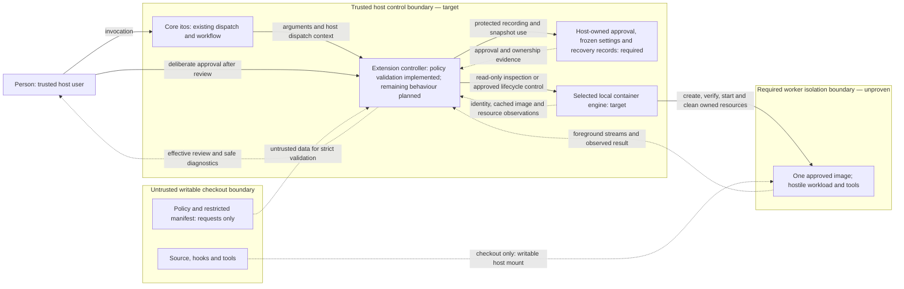
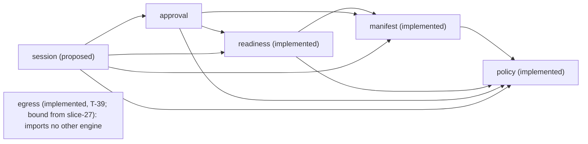

# Offline owned-run architecture

**Current design — accepted by the person on 2026-11-04; reconciled by T-19.**
This architecture is a hypothesis under the charter, not runtime isolation evidence.
Acceptance did not settle every security mechanism. The decisions below distinguish
what landed, what the person and coordinator settled, and what still needs specification.
The egress design added by T-38 is **proposed**, not accepted: the person confirms or
overturns it, as [the egress proxy record](../decisions/0022-egress-proxy.md) says.
The credentials design added by T-47 is also **proposed**, not accepted; the person
confirms or overturns [the credentials record](../decisions/0025-credentials-passed-in.md).
It defines two token kinds, no Codex delivery, and no permission to use real credentials.

The [charter](../charter.md) selects the milestone from the binding
[pilot contract](../plans/container-pilot.md); the [plan](../../PLAN.md) records that
scope and its order. The [architecture and Slices rules](../architecture.md) and
[accepted T-14 decision](../decisions/0001-enforce-slice-and-engine-boundaries.md)
govern package boundaries. Read this design with the
[T-11 lifecycle contract](../plans/offline-run-lifecycle.md), [CLI rules](../CLI.md),
[configuration rules](../CONFIG.md) and [working rules](../../AGENTS.md).
Those authorities bound this decomposition. The person's later milestone decisions
recorded in [T-19](../../tasks/phase-1.yaml) and revised A1 in
[q-2](../../tasks/asks.yaml) settle the choices identified below; broader pilot state
and hooks are later scope. This document does not expand the charter.

Throughout this document, **implemented** means present in this checkout;
**required** means behaviour specified by those authorities but not built;
**proposed** means an unbuilt responsibility within the accepted design hypothesis;
**blocked** identifies a person decision needed before dependent implementation;
and **deferred** means outside this milestone. A queued work item establishes neither
an implemented contract nor consent. Static document checks do not replace review.

## Goals

Run one coding workload and every tool it executes inside an explicitly approved,
offline worker for one checkout. The first milestone prioritizes isolation from the
host and all external networking, deliberate host-user approval, safe cleanup of owned
resources, and boundaries that can be tested independently and at runtime.

The required public operation is `itos container run -- <argv...>`: preserve explicit
arguments, run under an approved non-root identity, keep the checkout as the only host
filesystem mount, and remove owned ephemeral resources when foreground work ends.
Preserve checkout edits. A2 selects ephemeral tmpfs and excludes persistent worker
volumes, caches and profiles this milestone. Host approval, frozen configuration and
recovery records persist separately, outside the checkout. Init is deferred and no
lifecycle hooks run in this milestone.

Count, version and completion are implemented foundation and must remain intact.
Policy validation in doctor, including `doctor --policy-only`, is implemented by
slice-1 and bounded by slice-5. Its explicit policy scope does not establish manifest,
host readiness or approval inspection by that file-only mode. Ordinary doctor now
composes readiness and approval; slice-4 implements explicit approval and frozen input.
Run validates invocation and approval; offline startup and isolation remain unimplemented.
Neither policy/counting tests nor a passing Go suite establish a sandbox. Linux amd64
with native Docker is the target; support requires runtime evidence for that combination.

## Constraints

Assume hostile checkout code, arbitrary tool execution, dependency scripts and
prompt-injected instructions. Trust the host user, host controller, approved image
and selected local container engine. Containers do not defend against a host
administrator or kernel/container escape. The writable checkout is deliberately
exposed to destructive edits by its workload.

The person's q-30 decision accepts a first-milestone limit: host Unix sockets
created or swapped into the checkout after startup inspection remain reachable,
including during the run. Slice-19 requires only refusal of sockets found before
create, at any depth including `.git`, without following symlinks outside the
checkout. The check is implemented, with runtime green evidence still required,
and supplies no continuous IPC boundary. The
[scope decision](../decisions/0019-checkout-socket-milestone-limit.md)
overrides the isolation target here; kernel/runtime enforcement is deferred to
milestone 2 in [the research handoff](../plans/checkout-socket-enforcement.md).

Hooks, Git configuration and agent instructions are workflow safeguards, not isolation.
After worker edits, checkout hooks, builds, plugins and dependency installs stay inside
the sandbox until the person reviews them. Host inspection must not execute checkout
code or repository-configured helpers.

The milestone permits no network access, credentials/accounts, ingress, extra host
mounts, remote engine or linked worktree. It provides no host-home, engine-socket or
SSH-agent forwarding, arbitrary engine flags or Docker-in-Docker. No missing input,
unsupported setting or failed check can select an unrestricted fallback.

Those limits are the offline run's and stay as written. The second milestone's egress
profile is **proposed** and follows [the egress proxy record](../decisions/0022-egress-proxy.md):
it adds one owned proxy and its networks, grants the worker no other route, and widens none
of the worker's other limits. Only its engine package is implemented (T-39, tested over
loopback listeners and bound by nothing until slice-27), and none of it is proven on the
real engine.

The second milestone's credential grants are separately **proposed** in
[T-47](../decisions/0025-credentials-passed-in.md): per-command read-only binds of staged
token copies, with the checkout still the only host directory. This exception does not
change a run without grants. Codex sharing is blocked on the person's answer because
atomic replacement invalidates the charter's single-file premise; no replacement is chosen.

Work follows ports and in-memory fakes; agents have no Docker socket and real-engine
scenarios run only in CI. Dependencies need a maintained library, a reason in the owning
behaviour spec and a pinned version. The one deliberate exception is q-51's: the egress
proxy is our own code on Go's standard library with no dependencies, as the charter and
[the record](../decisions/0022-egress-proxy.md) state. This update records existing parser
choices and adds no library or network service.

Preserve donvargax's attribution and the project's [AGPL-3.0 license](../../LICENSE) and
[contributors record](../../CONTRIBUTORS.md). Permission to reuse the owner's itos and
itos-template infrastructure does not relicense those projects or dependencies.
T-14 records the provenance and retained AGPL-3.0 notice for its adapted architecture
fixture separately; preserve those notices when reusing that work.

## Context and scope

Core itos retains work routing, commit rules and CI proof. Its existing extension seam
dispatches `itos container` to `itos-container`; dispatch alone supplies no isolation.
The extension controller owns validation, approval and session lifecycle.
The following is a **required target context**, not a deployed sandbox. Dashed arrows
carry data or observations; solid arrows carry control or deliberate consent.

The controller validates data crossing from the checkout; it must not execute that
data. The worker cannot access host approval/recovery records, engine control or host
credentials beyond its explicitly approved grants in the proposed credential profile.
Token grants expose staged copies, not the original sources. The control arrow through
the engine is trusted orchestration, not an API exposed to the worker. The checkout
mount is intentionally writable, so edits return to the
checkout. No worker-to-network path exists in the offline run's required target, but the
accepted milestone limit above permits indirect access through host listeners
created or swapped into the checkout after inspection.

[CLI dispatch context](../CLI.md#extension-dispatch-and-environment) belongs to the
host controller. `ITOS_ROOT` does not establish safe checkout identity; `ITOS_CONFIG`
names core configuration, not `itos-container.yaml`. Inheriting host environment at
dispatch does not authorize forwarding it to the worker.

Credentials passed in per command are **proposed** by
[T-47](../decisions/0025-credentials-passed-in.md), for slice-29 through slice-33 and
T-48. Account management, network Git, LAN publishing, Compose services and other platforms are
**deferred**, as are the pilot's mitmdump guard and its HTTPS inspection and SSH tunnel
modes. Egress through an allowlisting proxy is the charter's second-milestone step 1 and is
**proposed**: [the egress proxy record](../decisions/0022-egress-proxy.md) fixes its design.
T-39 has built the proxy engine and T-40 the session lifecycle for its networks and
container. Neither is bound until slice-27. Slices 25 to 28 supply the command-facing
configuration, approval, delivery and durable refusal log; runtime proof remains pending.
Its context differs from the diagram above only for a run whose approved policy lists host
names: one owned proxy container, on its own egress network, reaches the listed names on
port 443, and the worker, on an internal network with no gateway, reaches only that proxy.
An offline run creates no proxy and no session network, and stays on `NetworkMode` `none`.
Init, lifecycle hooks and persistent worker project state are also deferred. Isolates,
WASM, a restricted shell and a capability broker remain deferred research. Later pilot
components and experiments require their own authorization and specifications.

## Solution strategy

Compose commands through shared engine domain/port contracts. Keep command handling,
domain decisions, I/O and rendering separate under T-14's existing enforcement:

- Commands use `internal/slices/<command>/{command,domain,port,<adapter>}`. Shared
  behaviour uses `internal/engine/<name>/{domain,port,<adapter>}`. Adapters are named
  siblings, never a generic `adapters` directory. Add no empty placeholder packages.
- Domains and ports perform no I/O and use the reviewed exact pure-package allowlist
  in [Slices](../architecture.md#slices) and [.golangci.yml](../../.golangci.yml).
  Domains use their own domain/port and permitted engine domain/port APIs. Ports own
  contract values and import only their own port subpackages and permitted engine
  ports, never domains.
- Commands are thin and perform no process, network or filesystem I/O. Adapters may
  use their own domain/port and permitted engine APIs. Only `cmd` binds concrete
  adapters. No slice imports another slice; no engine imports a slice.
- The generic UI imports no project package. `cmd` supplies each slice's failure
  classifier. Typed failures stay with their owning contracts; JSON, public rule IDs,
  exit codes and rendering stay outside domains and ports.
- These arrows also govern tests. Shared contracts and I/O-free stateful fakes live
  under the owning `port/porttest`; production never imports test support. Keep
  adapter-specific tests with their adapter and wiring tests at `cmd`.

The [T-14 decision and fixtures](../decisions/0001-enforce-slice-and-engine-boundaries.md)
are the enforcement reference, not a second allowlist maintained here. No new shared
package outside these roles or enforcement change is proposed.

Doctor, approve and run must reuse the same schemas, defaults, normalized contract
values and validation. Effective settings agree. As a temporary exception recorded in
[decision 0026](../decisions/0026-egress-allowlist-approval.md), doctor and approve accept
version 2 while run refuses it before later inspection until slice-27 proves enforcement.
Approval matching/canonicalization belongs to one shared responsibility,
not independent implementations in each command. A successful engine ping or a second,
permissive policy loader cannot establish readiness.

## Building-block view

The inventory separates existing packages from **proposed responsibility names**.
Unbuilt engines remain a design hypothesis, not existing packages, Go signatures or
record schemas. Settled choices constrain them without proving their implementation.

| Building block | Status | Responsibility | Dependencies and contracts |
| --- | --- | --- | --- |
| `cmd/itos-container` | Implemented assembly root, including policy-only doctor and run refusals | Assemble commands, ports, concrete adapters and classifiers. Preserve version/completion infrastructure without turning it into container slices. | Existing count, doctor, run, policy, generic UI and version leaf; remaining wiring only as specified. Slice-27 would also bind the egress adapter, `internal/engine/egress/tcp`, for the hidden `__egress-proxy` command. |
| `internal/cli` | Implemented | Generic output/error rendering, flag rules and completion helpers. | No project imports; command model and classifiers supplied by `cmd`. |
| `internal/version` | Implemented leaf | Build/version information. | No container responsibility. |
| `internal/slices/count` | Implemented | Preserve counting behaviour and Files contract. | `command`, `domain`, `port`, `disk`, `input` siblings; `port/porttest` fake and shared contract are test support. Input's disk port is wired by `cmd`. |
| `internal/release` and inherited release tooling | Implemented, separate | Existing release mechanics and tests. | No sandbox support claim; `releasetest` remains test-only. |
| `internal/slices/init` | Deferred | Non-runnable example generation belongs to later scope. | No init implementation authorized this milestone. |
| `internal/slices/doctor` | Implemented through slice-4 | File-only validation remains separate; ordinary doctor inspects checkout, engine, image and approval and prints the exact candidate fingerprint. | Shared readiness and approval ports; no state writes or checkout execution. |
| `internal/slices/approve` | Implemented by slice-4 | Show effective settings/differences and ask y/N at a terminal; offer optional exact-fingerprint approval only for offline grants without credentials. | Shared policy/manifest/readiness and approval contracts; no prompt again until settings change; never calls the doctor slice. |
| `internal/slices/run` | Foreground execution through slice-10; public registration through slice-11 | Validate argv and approval, publish frozen settings and a public recovery identity, then run one owned worker with bounded cleanup. | Shared approval/readiness/session contracts; literal argv, observed-exit precedence and exact cleanup retry. Native runtime proof remains CI-only. |
| `internal/slices/status` | Implemented by slice-11; native proof remains CI-only | Inspect project-owned sessions, original policy identity, controller presence and uncertainty. | Shared session contracts; read-only bounded inspection and safe schema-1 diagnostics. |
| `internal/slices/stop` | Implemented by slice-11; native proof remains CI-only | Finish cleanup of one registered session, independently of workload success. | Shared session contracts; mutation-time identity checks, per-session locking and durable repeated removal. |
| `internal/slices/exec` | Deferred | Additional argv only during a live owned foreground session. | Future session contract; cannot extend lifetime or alter frozen permissions. |
| `internal/engine/policy` | Implemented by slice-1, slice-5 and slice-25 | Closed schema/default/value validation for policy version 1 (offline) and version 2 (offline or an exact host-name allowlist), bounded parsing and typed failures. | Own domain/port, disk, YAML and IDNA adapters; reusable policy contracts and I/O-free porttest fakes. See [decision 0023](../decisions/0023-policy-version-2-allowlist.md). |
| `internal/engine/manifest` | Implemented by slice-2 | Restricted single-worker description and effective worker settings. | Policy domain/port contracts; own parsing ports/adapters. |
| `internal/engine/readiness` | Implemented prerequisite, extended by slice-20; slice-27's executable rule is built and not yet consulted | Read-only checkout, regular-file inode independence, local-engine and cached-image observations. The rule and ELF-reading adapter that judge the controller's own executable for delivery to the egress proxy (a regular static Linux amd64 image outside the checkout, read without running anything) exist with their shared contract; no command asks them until slice-27 wires doctor, approve and run. | Policy/manifest contracts; own inspection ports. No dependency on approval. |
| `internal/engine/approval` | Implemented through slice-26 | Effective host identity, canonical offline/allowlist profiles, shared sorted differences, q-52 terminal consent for network grants, protected recording and frozen input, cross-root control-state separation and durable location enrollment. | Policy, manifest and readiness; [canonical JSON SHA-256, protected storage and contracts](../../features/approval.feature). |
| `internal/engine/budget` | Implemented by slice-12 | Shared phase and finite-operation deadlines, late-result handling and retained handle lifetimes. | Context/time only; typed values in ports, policy in domain. |
| `internal/engine/session` | Owned creation, foreground execution and public recovery through slice-11 | Durable intent and registration, cross-project checkout admission, independently inspected ownership, uncertain-create reconciliation and confirmed removal. | Own domain/port, codec, disk, Docker SDK, entropy and presentation adapters; approval storage/frozen-codec and readiness identity contracts. Native signal and retained-isolation evidence remains CI-only. |
| `internal/engine/egress` | Implemented by T-39, not bound by `cmd` until slice-27; its design is still proposed (see the first paragraph), with no runtime evidence; real-engine proof in slice-27/28 | Our own CONNECT proxy on Go's standard library: CONNECT head parsing, exact name and port 443 decision, address check, ClientHello peek, replay and splice, and one-line JSON refusal records. No TLS interception, library or `net/http`. | Own `domain`, `port` with its `porttest` fake and shared contract, and the adapter `internal/engine/egress/tcp`; imports no other engine. Production code may import `crypto/tls` only in the adapter, held by `egress-tls` and `TestNoInterceptionCode`. `egress-x509` bans production `crypto/x509` imports; `egress-imports` restricts egress's dependencies. `TestNoRelaxingCode` rejects build constraints, platform-specific or ignored files, external settings reads and panic recovery. Fuzz tests cover head parsing and the peek. [Record](../decisions/0022-egress-proxy.md). |
| `internal/slices/egressproxy` | **Proposed**, slice-27; command package only | The hidden `__egress-proxy` command the proxy container runs: a thin handler over the egress engine's port, with `cmd` binding its adapter. | No domain or port directory of its own; no network I/O in the command. Not a public command. |
| Session networks and proxy (in `internal/engine/session`) | Implemented by T-40, unbound until slice-27; the design remains proposed as described above, with no runtime evidence | Create, verify, own and tear down the internal network, the egress network and the proxy container beside the worker, with durable intent before each and no fallback network. | Extends the session ports, fake and Docker adapter; ownership by durable intent, random name and inspected full ID, never labels alone. |
| Credential requests (in `internal/engine/policy`) | **Proposed**, slice-29; depends on T-47 and slice-25 | Version 3 extends slice-25's version 2 with optional closed credentials entries, exactly `kind` and literal absolute `source`; two token kinds, no Codex kind. | Versions 1/2 retain their meaning; shared pure validation, schema and file-only doctor modes. [T-47](../decisions/0025-credentials-passed-in.md). |
| Credential source observation (in `internal/engine/readiness`) | **Proposed**, slice-29; state-side mechanism unresolved | Shared descriptor-based metadata checks for doctor, approve and run: no symlinks, trusted ancestors, private owned regular single-link files outside checkout and control state, bounded size and distinct inodes. Exclude source inodes found anywhere in either tree, including mounted descendants, as well as root aliases. | Reuse the bounded checkout metadata scan; incomplete checkout observations refuse. Do not scan the host-wide state tree: slice-29 must settle bounded state-side exclusion independent of other projects' concurrent writes and retained history before implementation or handoff to slice-30, T-48 or slice-31/33. No content read, hash or log; own port and disk adapter beside checkout inspection. Only run later reads the checked inode. |
| Credential approval (in `internal/engine/approval`) | **Proposed**, slice-30 | Bind sorted `{kind, source, target}` grants, never contents, with `offline-credentials-v1` or `allowlist-credentials-v1`; review scope and exposure; apply q-52's terminal rule. | Reuse slice-26 canonicalization, differences and presentation. No-grant profiles keep their identity; source-content changes do not change approval. |
| Credential staging (in `internal/engine/session`) | **Proposed**, T-48 | Intent before private `/dev/shm` staging, exact read-only file mounts, verification before start, unlink after the start attempt and owned recovery. | Session ports, I/O-free fake, disk/Docker adapters and shared contract; slice-31/33 consume it. Lost acknowledgement after mount acquisition must retain uncertainty; Codex file delivery waits on question 1. |

Arrows below mean **proposed dependency on domain/port contracts**, not adapter imports
or runtime permission. Doctor composes readiness and approval inspection; readiness
never calls approval, so their composition creates no cycle.
Typed diagnostic contracts live with the policy, manifest and readiness engine ports;
doctor and approval share those rule/exit mappings without calling another slice.
The checkout port recursively requires one filesystem link per regular file,
including Git, hidden, ignored and untracked entries. Its disk adapter enumerates
pinned directories, reads link metadata without file contents or symlink traversal,
and refuses unavailable observations. Each scan, including revalidation, reads
at most 128 entries per batch and shares a 100,000-entry limit and 10-second
monotonic deadline across descendants through directory depth 64 (root depth 0).
Exhaustion refuses safety; time checks between synchronous filesystem calls do
not preempt a blocked kernel call. Approval does not cache this layout property;
the [shared-inode decision](../decisions/0013-refuse-shared-checkout-inodes.md)
extends admission and revalidation without adding link counts to the fingerprint.
Only cmd binds canonical encoding, effective identity, protected disk storage and
terminal presentation. The disk store locks pinned project directories, so read-only
inspection and frozen selection need no lock-file creation. It validates ancestor and
record ownership/permissions, compares generations under that lock, and publishes by
private-file fsync, rename and parent fsync. Consent waits hold no store lock.

Session storage reuses those pinned primitives through approval's `Storage` port.
An exclusive initial publication cannot replace an existing operation token. Owned
and absent updates compare the preceding complete record under the same protected
lock, whose acquisition honors the caller's deadline. Cleanup validates the original
snapshot without reading current policy, manifest or approval, then checks the selected
socket/daemon and inspects the full resource ID before removal. Name-only recovery
requires matching name and full-ID observations; a missing name after uncertain create
retains the intent. Explicit full-ID absence precedes a durable absent tombstone.
The local fake/HTTP scenarios establish this contract; CI alone establishes the native
Docker create/remove evidence. Neither establishes worker execution or isolation.

The [registry](../../tasks/work-items.yaml) records slice-1, slice-2, slice-3 and slice-5
complete; this checkout has live policy/parsing, manifest and readiness scenarios.
Work-item slices are increments, not commands or the pilot's numbered
milestone stages. Several extend doctor; slice-4 adds approve and approval inspection.

| Work item | Prerequisites | Shared outputs and consumers |
| --- | --- | --- |
| T-14 — completed foundation | Existing counting example | Slice/engine boundaries, classifiers, fake/adapter contract pattern and enforcement fixtures for all later packages. |
| slice-1 — completed policy validation | T-14 | Reusable schema, visible defaults, lexical paths, typed failures and shared contracts; doctor exposes policy-only scope. Live [policy scenarios](../../features/policy.feature) exercise acceptance, refusal and absence of effects. |
| slice-5 — completed bounded policy parsing | slice-1 | [Parsing scenarios](../../features/parsing.feature), v4 parser depth hook and aggregate limits below. Retains policy semantics and independent tooling v3 pin. |
| slice-2 — completed worker manifest | slice-1 | Own restricted fields, JSON-with-comments parser choice, environment and metadata treatment. Hooks do not run this milestone. Reuse policy contracts in doctor; later readiness/approval/run consume manifest values. |
| slice-6 — planned manifest/metadata bounds | slice-2 | Own manifest and image-label parsing budgets; policy limits do not establish them. |
| T-16 — completed engine-test tier | None | Guarded CI-only selection and required engine result; operational authority is [features/README.md](../../features/README.md). No live engine cases or isolation proof yet. |
| T-20 — completed runtime fixture preparation | T-16 | Own preparation of trusted images for real-engine scenarios; neither T-16 nor this document makes an image available. |
| slice-3 — completed readiness inspection | slice-2 and T-20; consumes slice-1 | Safe checkout/local-engine identity and cached digest/architecture/metadata inspection. Effective host UID resolution belongs to slice-4. The pinned engine client and HTTP Engine API fixture allow adapter tests without a daemon; a ping alone is insufficient. |
| slice-4 — implemented approval | slice-1, slice-2 and slice-3 explicitly | Implements revised A1's review, y/N prompt and optional fingerprint route, host effective UID/GID resolution with root refusal, matching/supersession, protected approval and frozen input. [Scenarios](../../features/approval.feature) specify canonicalization/storage and help/security wording. Doctor inspects approval; run blocks unapproved settings and names approve. |
| slice-7 — implemented invocation refusals | slice-1 | Local argv/JSON refusals introduce the run command slice; valid argv refuses until later increments. [Run scenarios](../../features/run.feature) cover redirected and real-terminal JSON, separator ownership and absence of effects. |
| slice-8 — implemented preflight and freeze | slice-4 and slice-7 | Revalidate prerequisites before resource effects, consume slice-4's approval/host identity and independent frozen input, and durably publish trusted session settings. No second identity resolver or approval loader. |
| slice-9 — planned owned create/cleanup | slice-8 and T-20 | Introduce session engine, fsynced intent, unstarted create, lost-response reconciliation, removal and absence confirmation. |
| slice-10 — offline foreground command | slice-9 | ID-OFFLINE-02/03 verify boundary and durable-ownership refusals; 06/07 cover literal argv and foreground streams; 13 covers explicit shell execution in the frozen workspace/environment. |
| slice-13 — planned launch and cleanup contract | slice-10 | ID-OFFLINE-01/04/05/15 cover ordered launch, frozen settings, checkout substitution and cleanup-failure precedence. |
| slice-14 — planned native isolation and teardown proof | slice-10 | ID-OFFLINE-08/09/10/11/12/14/16 prove identity, filesystem/network isolation, primary-exit teardown and native cleanup-failure precedence. Checkout plus tmpfs, NetworkMode none and pids 4096 remain the specified boundary. |
| slice-11 — planned status/stop | slice-10 | Actionable recovery, controller-loss candidates, foreign/repeated/two-project cases and safe diagnostics; protected records, random hex IDs, per-session lock and mutation-time revalidation. |
| slice-12 — budgets/cancellation/loss in progress | slice-11 | Calls 10 s, startup 120 s, teardown 30 s; reuse shared termination, forward once, 10 s grace, then SIGKILL; observed exit wins. |
| slice-15 — active controller-loss isolation regression | slice-12 and slice-14 | LIFECYCLE-15 retains isolation until explicit stop, using slice-14's independent boundary probes. All eight steps passed at e22aa63; q-32 accepts slice-12's existing behavior as regression coverage. [Evidence and activation checks](../../features/README.md). |
| T-38 — egress proxy record | Charter step 1 of the second milestone | [The egress proxy record](../decisions/0022-egress-proxy.md) fixes library (none: our own proxy, q-51), topology, delivery, failure closure and refusal log for T-39, T-40 and slices 26 to 28. Documentation only; no runtime evidence. |
| slice-25 — proposed egress allowlist in policy | None | Exact host-name allowlist in `itos-container.yaml`, validated by doctor without an engine or proxy. Offline stays the default. |
| slice-26 — implemented approval of the allowlist | slice-25 | `allowlist-v1` binds the canonical list and proxy digest; terminal review/status disclose handshake and logging limits and the remaining run gate. q-52 refuses network fingerprint approval. Shared comparisons explain changed fields without values in run. [Decision](../decisions/0026-egress-allowlist-approval.md). |
| T-39 — implemented egress engine | T-38 | `internal/engine/egress`: domain, port, adapter and fake, its three depguard rules and fixtures, and fuzz tests, all driven over loopback listeners without Docker. Nothing binds it until slice-27, and none of it is runtime evidence. |
| T-40 — implemented session networks and proxy | T-38 | Session ports, codec, stores, fake, Docker adapter and domain implement schema 3 ownership, ordered launch, proxy monitoring, stdout-only log reads and reverse teardown. Fake and HTTP-fixture tests cover them; no command binds the grant or refusal writer yet. |
| slice-27 — proposed run through the proxy | slice-26, T-39, T-40; the record also names `p1-acceptance-static-binary` | `internal/slices/egressproxy`, the hidden `__egress-proxy` command, the static harness build, and the real-engine scenarios, in CI only, that prove the topology, DNS and address rules. It edits `docs/security.md`. |
| slice-28 — proposed refusal log, failure stop and cleanup | slice-27 | The streaming writer for `egress-refusals.jsonl`, status and cleanup of the proxy and networks, and the proxy-failure scenarios (AC-17, AC-23 and AC-36), in CI only. |
| T-47 — proposed credentials decision | Charter step 2 of the second milestone and q-52 | [Record](../decisions/0025-credentials-passed-in.md) for sources, per-command staging, approval, uncertain starts, refusal-log conflict and six questions. Documentation only. |
| slice-29 — proposed credential policy and inspection | T-47 and slice-25 | Version 3 extends slice-25's version 2; source metadata observation, schema and CLI/config docs. Must settle and prove state-side exclusion independent of unrelated projects' writes/history before downstream handoff; no Codex kind until question 1 is answered. |
| slice-30 — proposed credential approval | slice-29 and slice-26 | Canonical grants, profiles, review, status and q-52's terminal rule; help and `docs/security.md`. Delivery remains gated. |
| T-48 — proposed session credential seam | T-47 and slice-29's state-side exclusion decision | Staging and recovery port, fake, adapter and shared contract, including lost start acknowledgement after mount acquisition. Bind-mounted Codex file half waits on question 1. |
| slice-31 — proposed Claude token delivery | slice-30 and T-48 | CI-only synthetic proof of approved read-only copies, project separation, absence checks and uncertain-start cleanup; refusal-log absence waits on question 6 and logging specs. |
| slice-32 — blocked Codex sharing | slice-30 and T-48; T-47 question 1 | No Codex kind or delivery until the person answers the atomic-replacement incompatibility and amends the charter as needed. |
| slice-33 — proposed GitHub token delivery | slice-31 | Reuse staging with a distinct grant; workload exports `GH_TOKEN` from its fixed file. CI-only synthetic proof includes uncertain start and, after question 6, the hostname-marker probe. |

The coordinator accepted the slice-10/13/14 scenario split on 2026-11-06.
[The offline feature](../../features/offline.feature) is the scenario ownership
authority; the eleven transferred cases remain `@wip` until their owning slices
supply passing evidence. This split changes delivery scope, not the runtime boundary
or the requirement for CI-only real-engine proof.

Each owning engine introduces reusable validation and port contracts with its work item.
Slice-17's [descriptor-backed anchor decision](../decisions/0020-descriptor-backed-checkout-anchor.md)
extends the existing session engine ports and adapters, with run remaining the thin
command consumer. Its Docker local volume mechanism is implemented with native proof
pending; it introduces neither another command nor another controller service.
Coordinator q-36 combines slice-18's accepted anchor recovery specification with
slice-17 in one pull request. The run, status and stop consumers share the session
engine; recovery completion requires confirmed worker and anchor absence. This
resolves delivery ordering only: both specifications retain their separate red-first
evidence requirements; local fake/adapter proof does not establish native green.
Shared contract suites under its `port/porttest` run unchanged against the in-memory
fake and adapters wherever applicable. Later consumers reuse those suites, normalized
values, typed failures and synthetic fixtures without importing
a sibling slice. Command classifiers translate failure data into public presentation.
Exact remaining contracts belong to the owning specs. Status/stop must be implemented
before run promises an actionable retry, even though the registry sequences slice-11
after slice-10. Do not turn planned increments into a completed recovery claim.

Test support has three distinct roles. I/O-free in-memory fakes exercise domain
decisions and shared port contracts. Slice-3's HTTP Engine API fixture supplies
controlled responses and transport failures to the real Docker-client adapter without
a Docker daemon; tests stay beside that adapter, never in production or I/O-bearing
porttest fakes. It checks request/response mapping and errors, not isolation. Finally,
CI-only `@engine` scenarios observe actual enforcement/lifecycle with prepared images
and independent controls. Neither a fake nor an HTTP fixture replaces that third tier.

Ordinary doctor is read-only inspection. The pilot separately proposes
`doctor --probe` for explicit bounded disposable runtime probes with trusted material,
no agent, no real credentials and no checkout scripts. It is not ordinary readiness,
has no implementation here and grants agents no local engine access.

## Runtime view

Policy-only doctor is implemented. The remaining flows are **required but
unimplemented**. T-11 supplies the detailed
[argument and JSON choices](../plans/offline-run-lifecycle.md#arguments-and-json),
[startup ordering](../plans/offline-run-lifecycle.md#ownership-and-startup) and
[result precedence](../plans/offline-run-lifecycle.md#workload-exits), with the later
settled milestone choices below replacing its open-choice and setup/state assumptions.

| Flow | Required success path | Refusal or partial failure; blocking decisions |
| --- | --- | --- |
| Doctor | File-only modes retain explicit scope. Ordinary doctor inspects the manifest, checkout, local engine, cached image and current approval. | Reject invalid requests without execution/acquisition/fallback. Missing/changed approval remains inspection-ready with explicit approve guidance. |
| Approve | Bare approve at a terminal shows effective settings and changes since last approval, then asks y/N. Matching approved settings prompt no more until they change. | Slice-4's fingerprint route remains for offline settings without credentials. q-52 requires terminal consent for network or credential grants: after inspection, any `--fingerprint` refuses with `approve.terminal-required`, exit 1, regardless of its value or existing approval. Bare non-terminal or JSON approval keeps `approve.confirmation-required`, naming only the terminal form for grants. No consent or invalid readiness means no recording. Allowlist consent is implemented in slice-26; runtime and credential grants remain with slice-27/30. |

Ordinary doctor and approve execute no checkout code, install no hooks, log in
to no account and pull/build/start no images or sessions. Approval cannot launch work.
Ordinary inspection refuses multiply linked regular files with
`doctor.checkout.hardlink` (exit 1, checkout root subject); an unreadable subtree
or exhausted enumeration budget uses `doctor.checkout.unavailable` (exit 3).
File-only modes make no layout claim.
Revalidation after engine inspection and consent detects a newly shared inode;
late launch validation refuses start while cleanup retains protected ownership.
Worker-created hard links within the sole checkout mount do not block recovery.
Init and lifecycle hooks remain deferred. The person never types a hash in the
terminal flow. A host agent can approve through the optional flag or a faked terminal:
approval records **what, not who**, and neither path proves human presence. q-52 has
answered the egress/credentials revisit: those grants refuse the flag, but the faked
terminal gap remains. Slice-30 carries the rule and disclosure into help/security wording.

### Foreground run and its failure paths

1. **Preflight, preparing.** After validating the invocation, start the single
   120-second startup deadline before preflight. Capture the first signal through
   cleanup and diagnostic delivery. Require nonempty executable argv after `--`. Preserve all
   subsequent argument boundaries without an implicit shell or injected agent flags.
   T-11 requires missing/empty-command refusal and wrapper/inherited JSON refusal
   before resources; a workload `--json` remains a literal argument. Then reuse strict
   policy/manifest validation, safe checkout/local-engine identity, cached approved
   digest/architecture/metadata and approval inspection. Missing, invalid, mismatched
   or superseded approval refuses before resource creation. Use the effective host
   UID, refuse root, and override the image with host UID/GID; manifest user values
   must equal the host UID, with no chown. Slice-4 owns this resolution, including
   omissions and rejection of explicit mismatches; image Config.User grants no
   identity. These choices avoid environment-derived identity and elevation while
   retaining host ownership of checkout writes. [Slice-4's spec](../../features/approval.feature)
   defines approval binding; slice-8 consumes it before resource effects. Local
   approval comparison uses validated effective values before opening the engine;
   daemon/image-dependent checks permit inspection only. Missing observations are
   never copied from approval to claim a fresh match.
2. **Frozen settings, preparing.** Capture validated effective configuration in trusted
   session material beyond worker control. Startup uses that snapshot. Checkout
   edits or later approval cannot widen the session; new permissions require a new
   approved run after stopping the old one. Slice-4 implements protected approval
   publication and atomic selection of independent frozen input; slice-8 durably
   publishes `snapshots/<project>/<generation>.json` under the approval state root
   and returns the exact selected value and durable reference to later startup.
   This material is not a session ID, recovery record or future run permit. Safe
   identical records are reused without rewriting; all reuse re-establishes file
   and directory durability. Uncertain publication returns no usable handoff.
   Every new invocation still validates current requests, identities and approval.
3. **Admit, create and own, preparing.** Slice-19 requires a checkout
   socket inspection before create: refuse any Unix socket at any depth, including
   `.git`, without following symlinks outside the checkout, with typed isolation
   refusal and no created worker. This is a startup check, not continuous
   enforcement; sockets created or swapped in after inspection remain reachable
   (q-30). The session workspace port implements this check during pinning,
   before the engine create call. Its disk adapter walks the pinned root with
   standard-library traversal; scan failures release the pin and prevent create.
   Q-34 accepted all 12 ID-SOCKETS-01 red rows; runtime green remains required.
   Slice-16 atomically reserves the validated
   canonical checkout under private coordination exclusion shared with approval
   publication before registration or
   create. Strict ancestor/descendant roots conflict across projects and daemons;
   equal roots and disjoint roots retain concurrency. Legacy registrations without
   admission metadata remain authority. The lock spans short storage transactions,
   never engine calls or session operation locks. See
   [the admission decision](../decisions/0014-checkout-admission.md) and
   [control-state publication](../decisions/0021-control-state-publication.md).
   New foreground runs publish a reserved intent before public registration, then
   clear the pending reservation marker durably before receiving launch authority.
   Advance the intent with `fsync` under the operation lock before create,
   then create unstarted. Reconcile a lost response using the trusted record plus a
   random name before launch or cleanup, closing the untracked-create window.
   Schema-2 foreground intents publish anchor intent before volume allocation and
   independently inspected concrete anchor ownership before worker creation.
   Worker creation mounts that exact volume at `/workspace` with copying disabled. Names
   or labels alone never authorize adoption or deletion. Durably record concrete
   resource identity before any entrypoint or workload instruction. A failed record
   write prevents execution and enters bounded cleanup/recovery. Retain uncertainty
   rather than launching or blindly creating a duplicate. Slice-9 specifies and tests
   this protocol. Its unstarted-only operation remains separate from slice-10's
   foreground operation, which consumes the same protected store and bindings.
4. **Verify, then ready.** Verify every required boundary before any worker instruction.
   Unverifiable isolation refuses later execution and enters cleanup/recovery.
   Use `NetworkMode` `none`, inspected before start, with network and DNS probes
   proving denial independently of proxy variables from the first instruction and
   through controller loss. Inspection alone is not runtime proof. Slice-10 owns
   this evidence, including read-only root, host UID/GID, checkout-only host mount,
   ephemeral tmpfs and pids limit 4096. No lifecycle setup hooks run.
5. **Launch, running.** After verification, attach to the explicit foreground argv
   under frozen settings. Launch/attach uncertainty requires reconciliation, not a
   fabricated exit. Cancellation stops later phases and accounts for in-flight work.
   Calls have a 10 s budget within 120 s total startup. Retries/progress cannot reset
   totals. Slice-12 owns enforcement, remaining cancellation mappings and loss cases.
6. **Finish, stopping.** Observed primary exit ends the session and begins bounded
   owned cleanup. Confirm removal/absence before claiming stopped. Incomplete cleanup
   retains failed-state recovery information. Teardown has a 30 s total budget.
   Slice-10 now wires the foreground lifecycle through the session engine, with
   a separately pinned workspace and Docker SDK stream demultiplexing. The wait
   handshake is bounded; acknowledged workload wait has no lifetime limit.
   Forwarding failures cancel the pending workload wait and trigger bounded cleanup.
   Run captures SIGINT/SIGTERM before startup, forwards the first signal once after
   reacquiring owned authority, allows grace until 10 s from cancellation, then
   escalates to SIGKILL within the same 30 s teardown budget. Signal delivery
   consumes grace. Repeated signals cannot interrupt that cleanup. Final output
   drains concurrently with owned cleanup for at most 10 s within that total;
   expiry closes the owned attachment immediately so backpressure cannot keep
   the engine's exit observation blocked until cleanup returns;
   a blocked consumer cannot retain the operation lock or hold removal.
   Slice-11 adds executable status/stop; native signal and retained-isolation proof
   remains with slice-12 and the guarded CI tier.
   See [the foreground integration decision](../decisions/0008-foreground-run-integration.md).
   [The failure-cleanup decision](../decisions/0009-foreground-failure-cleanup.md)
   records the review fixes and their local controller proof.

### State and result interpretation

Slice-17's selected change to the sequence above is pending native proof. Publish
an owned local Docker volume before worker creation, using `type=none`, `o=bind`
and the controller's `/proc/<pid>/fd/<n>` O_PATH descriptor as its device. Keep the
descriptor open from the final identity check through `ContainerStart`'s return.
The worker consumes that volume at `/workspace` without copying. The anchor itself
must prevent substituted-inode execution. Immediately after start returns, inspect
`State.Pid`, hold a pidfd and re-inspect the same owned full ID and live PID before
statting `/proc/<pid>/root/workspace` from the host. Check the held process on both
sides of stat and compare device/inode with the validated identity. A mismatch or
an unreadable workspace outside q-42's root-change errors triggers immediate owned
kill/removal and refusal. Under q-42, ENOENT, ESRCH or EACCES requires polling the
held pidfd: an exited worker follows q-39, while a live worker continues with
`mount_detector` recorded and shown in JSON/text status as
`not observed: worker root changed`. A failed process observation still refuses.
Under q-39, an independently confirmed exited worker retains its
real wait result and normal cleanup, with `mount_detector` recorded and shown in
JSON/text status as `not observed: worker exited`. Only an actual identity match
on the guarded live process records `verified`; refusals record `refused`.
When kernel process absence precedes Docker's exit publication, reconcile the
same owned full ID with an engine not-running wait and fresh exited inspection
within one ten-second call budget. Retain that observed exit without a second
wait. Process absence alone, changed identity, wait failure or expiry grants no
success; other syscall errors still refuse without this wait.
Legacy records have no detector observation and never imply verification. This detector is not the protection. No raw-path
fallback, gate binary, extra mount, new controller privilege, host
mount by the controller or long-lived helper is selected. The native race must
prove original-inode execution or refusal before this hypothesis is accepted.

The coordinator accepted OFFLINE-29's four native race failures at `51a9f48`
on Docker 28.0.4. Q-27 settles the detector above without adding a mount/start
gate: Docker's start operation also starts the task. A detector failure after
successful start must fail native acceptance. The selected volume mechanism
is implemented after accepted red checkpoints; native green remains required.
The source evidence and settled ordering are recorded in the
[descriptor-anchor decision](../decisions/0020-descriptor-backed-checkout-anchor.md#implementation-checkpoint-and-settled-detector).

These are T-11's interface meanings, not a storage schema or proof of a transition.

| State | Meaning and allowed progress |
| --- | --- |
| preparing | Preflight, frozen settings and resource creation/verification; foreground not launched. Success reaches ready. Failure/cancellation enters stopping when cleanup is needed, otherwise records failure. |
| ready | Boundaries verified and ownership durable; launch proceeds directly, with no lifecycle hooks. Failure/cancellation enters stopping. |
| running | Foreground launched under frozen settings. Observed exit/cancellation enters stopping; controller/engine loss is not observed termination. |
| stopping | Bounded owned cleanup, including partial startup and already stopped workers. Confirmed completion reaches stopped; incomplete cleanup reaches failed. |
| stopped | Required ephemeral cleanup confirmed, including recorded resources confirmed absent. Workload result and checkout edits remain; no persistent worker state or restart authorized. |
| failed | Startup/controller failure or incomplete cleanup. Report present/uncertain resources separately; later authorized stop may resume stopping. Never imply removal from this state name. |

Preserve an observed nonzero workload exit even when cleanup fails, with a separate
cleanup diagnostic and recovery reference. If the workload exits zero but required
cleanup fails, return a nonzero wrapper failure classified by its cause. T-11 retains
the CLI wrapper meanings, rather than importing helper-tool codes or treating every
cleanup error as transient. Return zero only with known successful work and cleanup;
observed exit wins over an inferred signal outcome. Forward a signal once, allow
10 s grace measured from cancellation, then SIGKILL if needed. Report
`run.cancelled` and the first signal separately. With no observed exit, SIGINT
returns 130 and SIGTERM returns 143; these are wrapper outcomes. Observed zero
with successful cleanup and streams returns zero. `run.engine-lost` and
`run.stream-timeout` remain failures even with observed zero. Nonzero observed
exit retains precedence over each of these failures.
[The lifecycle result decision](../decisions/0016-cancellation-and-output-drain.md)
supersedes 0009's provisional cancellation result.

Pre-launch refusals have no child status. Lost engine/controller observations never
become invented workload success or failure: a surviving controller reports its
classified nonzero failure and an unknown child outcome; a dead controller cannot
return a result or run cleanup. Signal delivery is not termination evidence.

### Recovery

Slice-16 retains registered checkout reservations through controller loss and uncertain cleanup.
New runs publish a `reserved` intent before registration, and advance it durably to
`intent` under the operation lock before sending create. Stop can instead durably
cancel a reserved intent, publish stopped progress and certify completion without
an engine call or an invented worker ID/exit. Once create may have been sent, only
durable absent intent and stopped public session, following fresh full-ID absence,
permit completion certification under the common admission lock. Repeated stop can
re-establish that evidence for legacy sessions. Existing operation-lock state checks
fence stale create/start continuations before a nested checkout is readmitted; controller
lease release is unnecessary. Each same-root session releases independently. Admission
never contacts another project's daemon and status/stop keep their original scope.
An independently retained `stream-timeout` on a stopped public record does not
invalidate its matching completion certificate or block subsequent admission.
Every other retained failure, a non-stopped record or mismatched intent still
refuses a claimed completion; output loss cannot release an incomplete reservation.
Admission marks claims pending until public registration succeeds durably. The common
lock lets admission ignore only a pending claim with an absent public record; that
publisher cannot still grant launch authority. Active and legacy claims, visible
registrations, and unreadable or unsafe state retain their conservative rules.
See [the admission decision](../decisions/0014-checkout-admission.md).

Status inspects owned sessions after partial startup, lost create response, cancellation,
engine loss or controller interruption. Stop cancels a live owned session or resumes
cleanup using revalidated trusted ownership and concrete resource identity. Refuse
wrong-user, foreign, mismatched or ambiguous resources; labels/names only corroborate
ownership. Confirmed-absent recorded resources are safe on repeated stop; an unreachable
engine does not establish absence. Never prune unrelated resources or remove shared
images or checkout edits. Worker tmpfs is ephemeral; persistent worker state is excluded.

Place recovery records beside approvals in protected host state. Slice-11 uses
independent random 32-byte lowercase hex IDs and seven-field records referring to
the original intent. Persistent controller and operation descriptor locks separate
liveness from mutation exclusion. Status probes the controller with a shared lock;
run and stop serialize transitions, revalidation and durability, releasing the
operation lock during foreground wait and output draining. Project transactions
never span engine calls. A controller-probe error leaves presence unknown and
does not veto explicit stop; ownership validation remains independent. Expiry
during stop inspection or either termination wait remains temporary and cannot
authorize a progress write beyond the total budget. When a concurrent stop completed
the same worker, run reconciles cleanup independently of the workload result,
preserving null and draining remaining output. Without an observed exit or another
failure, run returns wrapper exit 75 and `run.workload-exit-unknown`, explaining
that the workload exit is unknown and cleanup is complete, with no cleanup retry.
Stop and status still succeed; no synthetic exit or last problem is persisted.
If the initial stdin probe times out on that stop's operation lock, run retries
the completion check
within its existing teardown total. Incomplete or conflicting authority and
forwarding errors still fail.
See [public session recovery](../decisions/0010-public-session-recovery.md).
[Unknown workload exit](../decisions/0015-unknown-workload-exit.md) corrects the
earlier concurrent-completion success claim; known nonzero exits retain precedence.

For slice-17's mount-bearing sessions, the labelled volume and protected
ownership survive incomplete worker removal. Release the volume only after worker
absence is confirmed, then durably complete the session. The controller descriptor
need not survive controller exit; neither its expired `/proc` path nor a stopped
worker's mount is a recovery source. Slice-18, integrated into slice-17 under q-36,
adds volume release to fresh-process recovery. Never recreate the source from the current checkout path, and refuse
unknown mount-bearing records rather than silently treating them as worker-only.

The protected schema-2 intent binds the anchor's session, random operation name,
descriptor source, validated device/inode and independently observed creation
identity. Recovery compares the exact local driver/options and seven ownership
labels on the original daemon; it never dereferences the saved source. Release
requires full worker-ID absence, followed by a fresh anchor inspection, owned
non-force volume deletion and independent absence confirmation. Reserved intents
can be cancelled under the operation lock to fence later create before release.
Any uncertain create, deletion or durability retains the original authority.
The same teardown path serves foreground run and fresh stop.

Status extends its existing envelope with an independent `anchor` fact for
schema-2 sessions: present, absent or unknown. Worker absence alone is pending;
completion requires fresh absence of both resources and durable intent/anchor/
public completion. Legacy schema-1 entries omit this field and keep their old
contract. Stop reloads and syncs completed evidence without rewriting it or
repeating removal. Anchor inspection/deletion share the existing whole-command
budgets and per-session lock; another session remains independent.

Fresh recovery discovers registrations through the protected
`sessions/<lookup>/<id>` index, where lookup hashes the host UID and canonical
checkout path, independently of mutable Git identity. Each record still binds
its original approval project, intent and snapshot. The snapshot's root and
host identity must match the invocation; moving a registration into a foreign
root's index cannot authorize cleanup. Recovery derives the key from the absolute
effective root path without opening the worker-controlled checkout; removed read
or search permissions cannot veto cleanup. Launch retains full checkout validation.
[Stable recovery discovery](../decisions/0011-stable-recovery-index.md) supersedes
the project-keyed public lookup in decision 0010;
[recovery without checkout access](../decisions/0012-recovery-without-checkout-access.md)
supersedes decision 0011's remaining checkout-root pinning requirement.

Foreground cleanup authorizes removal from the protected original record/snapshot,
current host identity, selected original daemon and freshly inspected full resource
ID. It does not reopen or compare the writable checkout: a worker can replace `.git`
without gaining authority over protected ownership or vetoing cleanup. Fresh checkout
validation remains mandatory for launch. Slice-9's unstarted-only operation retains
its existing stricter checkout validation.

Retain recovery information until cleanup is confirmed. Report the owned session ID
and an exact safely rendered `itos container stop` retry containing that ID, as
[T-11 requires](../plans/offline-run-lifecycle.md#cleanup-and-recovery). Status/stop must
be specified and built before run can promise an executable recovery path.
These safety requirements need executable evidence for concurrency, uncertain creation,
wrong-user/foreign/ambiguous refusal, repeated stop and independent projects.

Under A3 the worker stays isolated after controller loss until stop. Status shows
sessions that lost their controller as candidates to stop; no new list command is
introduced. Do not promise a watchdog, instantaneous cleanup or a known child exit
after observation is lost. Isolation must remain closed until confirmed removal.
There is no detached lifetime or unattended restart. Preserve the future exec invariant:
primary exit refuses new exec and tears down active exec commands without extending
lifetime. Exec implementation remains deferred.

Slice-21 retains a location catalog under the effective account home's fixed
`.local/state/itos-container/coordination` anchor. The Linux host adapter requires
the effective UID's local `/etc/passwd` record; it refuses missing or unreadable
account evidence, including NSS-only accounts in the CGO-disabled release.
HOME, USER and LOGNAME cannot supply a fallback account home. After validated mkdir
bootstrap, its private 0600 control.lock inode supplies bounded exclusion for catalog access
and selected-root publication across HOME/XDG selections; the home is never locked.
The coordination directory is reserved for metadata: selected managed roots equal
to or below it refuse with state.path before bootstrap or enrollment, preventing
ordinary state entries from invalidating the shared catalog. This whole-component
rule still permits the default tree and similarly named sibling directories.
Session and admission collection namespaces are likewise reserved in the fixed
tree and every enrolled location, including pending claims. Selections inside
these collections refuse before any binding or selected-tree creation; discovery
rechecks them under the common lock so subsequent reservation scans remain usable.
Doctor inspects without writes, taking a shared lock when present; approve
and validated run enrollment complete durable self-binding and selected-location
claims before ordinary state writes. Existing reservation completion semantics are
shared with separation checks, without operation locks or engine calls. The
transaction also refuses a candidate checkout that equals, contains or lies
beneath any retained managed location or the fixed or selected tree, including
pending claims without a directory: a checkout below a managed tree is mounted
read/write and reaches its approvals collection exactly as one above it does. Both
read inspection and admission enforce this by whole path components in both
directions; admission rechecks under exclusion
after preflight, preventing a later worker from exposing an earlier publication. The
same two-way comparison applies to the reserved roots of workers already active: a
fixed or selected tree that equals, contains or lies beneath one refuses with
approval.state.exposed, so a selection above a running worker cannot be enrolled. Catalog bindings match their locations by path and inode, never by a
persisted device number, which a reboot can renumber. The catalog stores each path as
JSON, which rewrites an invalid UTF-8 byte, so a selected tree (state.location) or
account home (state.unavailable) whose path is not valid UTF-8 refuses before bootstrap. The
[control-state decision](../decisions/0021-control-state-publication.md) defines
bootstrap/retry ordering and the legacy discovery limit. Broader mount enforcement,
native evidence and recovery trust checks remain slices 22 and 23; unseen pre-upgrade
roots and mixed controller versions require a separate upgrade contract.

### Egress run

**Proposed**, for a run whose approved policy lists host names. T-39 implements the proxy
side of steps 2 to 4, tested over loopback listeners. T-40 implements the session engine
side of creation, readiness, monitoring and teardown, tested with fakes and an HTTP Engine
API fixture. Command wiring and the durable refusal-log writer remain unbuilt. Every
runtime claim awaits slice-27 and slice-28 evidence on the real engine, in CI. An offline
run keeps the sequence above with `NetworkMode` `none`, no proxy and no network. The reasons
and measurements are in [the egress proxy record](../decisions/0022-egress-proxy.md).

1. **Create, in order.** The checkout pin, its socket scan and the anchor come first, so a
   refused checkout starts no proxy. Then the internal network (Internal true, IPv6 off,
   `com.docker.network.bridge.gateway_mode_ipv4=isolated`, which needs Docker 28.0), the
   egress network, and the proxy, each with durable intent before it. The proxy joins both
   networks, publishes no port and runs the host's own static itos-container executable,
   bind-mounted read-only, as the hidden `__egress-proxy` command over an inert, digest-pinned
   root filesystem. Run verifies the networks (internal, IPv6-off, isolated, no IPAM
   gateway) and the proxy (exact Cmd and Env, `net.ipv4.ip_forward=0`) by inspect before
   starting it.
2. **Ready, then the worker.** The proxy prints one `ready` record only after validating the
   list and listening; the controller reads it inside the existing 120 s startup budget.
   Only then is the worker created, on the internal network alone, with the proxy's literal
   address in `HTTP_PROXY`, `HTTPS_PROXY` and their lowercase forms and `NO_PROXY` set to
   loopback. The variables help cooperating clients; the worker's closure rests on its having
   no route, not on them.
3. **Each connection.** The proxy reads a CONNECT head, admits only a listed name on port
   443, dials with every address checked against the special-purpose table, answers 200,
   reads the first ClientHello without completing a handshake, requires its SNI to equal
   the CONNECT name (a missing SNI, ECH and non-TLS bytes are refused), replays every byte it
   read after the head upstream untouched and splices both ways. It holds no CA, certificate or key. It cannot
   see the HTTP Host or anything after that hello.
4. **Failure closes; there is no fallback network.** A missing ready, a proxy exit or an
   unverifiable resource creates no worker. The proxy recovers no panic and ends on an
   Accept error, a failed write to its stdout or the 20,000th refusal (`log-full`). During a
   run the controller also waits on the proxy, and its exit is a typed failure: the worker
   gets the existing termination, an observed exit keeps its precedence and run returns
   nonzero. Nothing reconnects the worker or restarts the proxy. Under A3 a lost controller leaves
   both running under the frozen list until stop.
5. **Teardown reverses creation.** The worker, then stop the proxy and confirm it has
   exited, then copy its refusal log to `sessions/<lookup>/<id>/egress-refusals.jsonl`
   under the protected state root, then remove the proxy, the egress network, the internal
   network and the anchor. A failed step keeps its recovery record and exact retry, and a
   failed copy keeps the stopped proxy and its log. Removal is authorized by durable intent
   and the inspected full ID, never by labels or names alone.

The refusal log is described under Cross-cutting concepts. Offline recovery, status and stop
keep the rules above; slice-28 extends them to the proxy and the networks.

### Credential run

**Proposed**, under [T-47](../decisions/0025-credentials-passed-in.md), not runtime
evidence. Slice-31 owns `claude-token` and slice-33 `github-token`, using T-48's shared
session seam. Codex has no kind or delivery pending question 1. The person's question 5
must be answered before any real credential is used, including a smoke check.

1. **Validate and freeze grants.** Slice-29 initially admits version 3 only in doctor's
   file-only modes; ordinary doctor, approve and run refuse it with `policy.version`.
   Slice-30 admits inspection and approval only after slice-29 specifies and proves
   the state-side exclusion mechanism; run still refuses unavailable delivery
   kinds and an allowlist until slice-27, before manifest, engine or host state. Once
   admitted, reuse readiness's source observation and approval's frozen grants. Check
   all sources without reading contents: no symlinks, trusted ancestors, outside the
   checkout/control roots and their descendants by device/inode, private host-UID-owned
   regular single-link files of 1–65536 bytes, distinct inodes. Compare each checked
   source against every regular file in the bounded checkout scan, including mounted
   descendants; an ancestor walk alone misses aliases of subdirectories. Incomplete
   checkout scans and budget exhaustion refuse. The host-wide protected state tree
   must not be scanned with those rules: concurrent publication/removal and accumulated
   unrelated history would break project independence. Slice-29 must settle and prove
   a bounded state-side exclusion preserving descendant-alias refusals before T-48
   or delivery slices take this design. Until then only file-only policy parsing is
   admitted. A failed check prevents staging and create.
2. **Read and stage.** Only run reopens the checked descriptor to read the current
   bytes once; short or changed-size reads refuse. Publish the directory name in durable
   intent before creating `/dev/shm/itos-container-<32 random lowercase hex digits>`.
   Require tmpfs by `statfs`, directory mode `0700`, host ownership and descriptor
   validation; an existing name refuses. Create exclusive no-follow files of mode
   `0400`, copying the exact untrimmed bytes. Host swap remains a limit. No bytes enter
   records, configuration, Engine API bodies, controller Env or argv.
3. **Create and verify.** Add only the approved staged read-only binds at
   `/run/itos-container/credentials/claude-token` and/or
   `/run/itos-container/credentials/github-token`. Their values are absent from
   `docker inspect`, though paths are visible. Verify the exact sources, targets and
   read-only flags alongside the existing checkout volume and `/tmp` tmpfs before
   start. The worker has private IPC and its own `/dev/shm`; it never sees host staging
   directories or original token sources. Provisioning failures before any start
   attempt prevent launch and trigger owned cleanup as needed.
4. **Start attempt and unlink.** After the controller's start wait and any applicable
   mount detector return, whatever their answers, attempt to unlink every staged file
   and remove its directory; record absence only when confirmed. An acquired mount or
   open reference survives unlink. A lost start acknowledgement after mount acquisition
   can therefore accompany delayed workload execution with the credential bytes.
   Neither unlink, a timeout/start error nor restart policy `no` fences that late start
   or proves that no workload ran. No repeated start or restart is authorized.
5. **Reconcile and clean up.** An uncertain start retains original protected identity,
   reconciles the owned full ID under decision 0017's existing budgets and attempts
   owned termination/removal. An unobserved workload outcome stays unknown. Missing
   staged paths do not establish worker absence or completed credential cleanup;
   completion requires both confirmed worker removal and staging removal, alongside
   all existing owned resources. Lost controller recovery removes staging by intent
   only after owner/mode/expected-name checks. Unsafe or unavailable observations keep
   recovery and its exact stop retry. Reboot clearing tmpfs supplies no workload result.

Each later run reads fresh sources; a live worker retains its acquired copy until its
mount is torn down. Status shows the frozen grants and present/absent/unknown staging
state during recovery. Workload argv may export the file contents to
`CLAUDE_CODE_OAUTH_TOKEN` or `GH_TOKEN`; automatic harness setup is later scope. T-48's
fake/adapter contract and slice-31/33's CI cases must cover acquired mounts, missing
acknowledgements and delayed completion after unlink. Refusal-log absence additionally
waits on question 6 and its adversarial hostname-marker probe below.

## Deployment view

The selected slice-17 anchor uses the already trusted native dockerd to perform
the descriptor-backed bind. It adds one labelled local volume as session control
infrastructure, not another host-source grant or persistent worker data store.
The worker mount retains the original inode while the worker lives; no new helper
has to outlive the controller. This topology remains a hypothesis until guarded
native red/green evidence establishes it on the actual CI daemon and kernel.

This is a **required target placement**, not a working deployment. The selected host is
Linux amd64 with native Docker, subject to runtime evidence. The selected engine
settings require independent runtime probes; inspecting a flag cannot prove enforcement.

| Location | Required contents and access | Status or decision boundary |
| --- | --- | --- |
| Trusted host | Person, core itos dispatch and extension controller; local engine control available only to trusted orchestration. | Agents receive no socket. Slice-4 specifies effective host UID identity, root refusal and effective UID/GID worker resolution; runtime enforcement remains planned. |
| Host-owned state outside checkout | Approval records, trusted frozen configuration and recovery records under `$XDG_STATE_HOME/itos-container`, directory mode `0700`. | Worker must not access them. Slice-4 specifies canonical JSON SHA-256, `0600` active records and independent frozen input; slice-8 publishes session snapshots, with recovery in slices 9/11. Slice-21 protects publication with a persistent account-home catalog across selected roots. This state is not a persistent worker volume; inaccessibility still needs runtime proof. |
| Untrusted checkout | Source, request policy and restricted manifest; writable by the worker. | Its only host directory, mounted through the descriptor-backed owned volume; proposed credential grants add staged single-file binds only. Substitution protection requires native proof. |
| Local engine image store | Approved cached manifest digest, checked for architecture, compatibility and metadata. | The person pulls the manifest's digest and approval binds that content. Control commands inspect, never pull/build/substitute, keeping acquisition a deliberate host operation. Slice-3 owns checks; T-20 owns fixture preparation. |
| Worker | Host UID/GID override image identity; manifest user values must match, no chown. Read-only root, `no-new-privileges`, no administrative capabilities, sudo, host namespaces or engine/SSH-agent sockets. **Proposed** grants expose only approved mode-`0400` read-only token files under `/run/itos-container/credentials`, never original sources; private IPC keeps host `/dev/shm` inaccessible. | Required from first instruction; pids limit 4096, no memory or CPU quota claim. Offline proof is separate from slice-31/33's still-unproven credential boundary. |
| Container-managed storage | Ephemeral tmpfs and the owned anchor control volume; checkout writes survive on its sole nonrecursive directory bind source. Proposed credential profiles add read-only binds of staged files, not writable credential volumes. | No persistent worker volumes/caches/profiles, host `/tmp` or host-wide chown. A2's offline limits hold; T-47 names the credential proposal's contract exceptions. |
| Host `/dev/shm` staging (**proposed**, T-48) | One random host-UID-owned `0700` directory per run; exclusive `0400` token copies, tmpfs verified. Durable intent names it before creation; each worker gets only its own file mounts. | Rootful dockerd in the host mount namespace is assumed. Host swap can persist bytes. Unlink after the start attempt does not revoke acquired mounts; completion needs worker and staging removal, with recovery on uncertainty. |
| Worker network boundary, offline run | `NetworkMode` `none`, inspected before start; no external network path or published port from the first instruction. | Independent network/DNS probes must prove denial through controller loss. An offline run has no proxy, guard or session network; `NetworkMode` `none` is confined to offline runs. |
| Session networks, egress run (created by T-40's session engine, unbound until slice-27) | Two owned per-session bridge networks. The internal one has Internal true, IPv6 off and `com.docker.network.bridge.gateway_mode_ipv4=isolated`, so its bridge has no address; the worker joins it alone. The egress one is a plain bridge with IPv6 off and only the proxy on it. | Docker 28.0 or newer, else an unavailable control. Docker's embedded resolver at 127.0.0.11 stays, with no route behind it; AC-11 is the result to prove (q-50, provisional). Nothing is proven until slice-27 runs on the real engine. |
| Egress proxy container (created by T-40's session engine, unbound until slice-27) | Runs the host's own static Linux amd64 itos-container executable as `__egress-proxy`; that read-only bind mount is its only mount. Both networks, no published port, listening on 3128, forwarding sysctl off. The root filesystem is the inert pinned busybox. Host UID/GID, read-only root, CapDrop ALL, no-new-privileges, pids limit 4096, no restart, no checkout, state volume or socket. | The person pulls the image; commands only inspect it, and approval binds its digest. Platforms other than Linux amd64 cannot run egress this way. The worker cannot reach the executable, Cmd or Env. Refusal records land in the json-file log and, at teardown, in `egress-refusals.jsonl`. |
| Disposable CI runtime environment | Prepared trusted test images, disposable checkouts/state, controlled probes and independent engine observations. | T-16 implemented the guarded engine tier, separate from socket-free agent work. T-20 still owns images; there are no live runtime cases. No valuable credentials or checkout-controlled host setup. |

Engine access in CI does not extend to the coding agent. Local domain/contract tests
use I/O-free fakes. Portability builds and tests on another host do not validate this
placement or authorize a new supported engine/architecture combination.

## Cross-cutting concepts

**Strict data and shared resolution.** Follow [CONFIG's data rules](../CONFIG.md#data-and-validation)
recursively, including mappings inside lists: reject duplicate, unknown and non-string
keys, multiple documents, anchors, aliases, merge keys and non-JSON/custom tags. The
permitted non-specific `!` spelling and JSON-type tags cannot construct objects or
expand anything. Validate every value against the specified schema before use; neither
empty/missing data, ignored `x-` keys nor an inferred version is acceptable. The
restricted manifest's exact JSON-with-comments syntax needs its own reviewed parser
and field contract in slice-2, with no host interpolation or Dev Containers CLI fallback.

**Implemented policy bounds.** Slice-1/5's policy adapter uses `go.yaml.in/yaml/v4`
`v4.0.0`, pinned in [go.mod](../../go.mod). Slice-5 selected its `LoaderLimitsPlugin`
depth hook to stop excessive nesting during parsing, including incomplete documents;
v3 exposes no configurable parser-depth hook. The independent tooling
`go.yaml.in/yaml/v3` `v3.0.5` pin remains. The whole-source cap is 65536 bytes.
Scanning/parsing permits at most 32 open flow collections and 32 active block levels;
mixed inputs must also satisfy the representation depth limit of 32. Before value
conversion/diagnostic allocation and the second-document check, cap the representation
at 2048 nodes and 65536 aggregate escaped path bytes. The second read uses the same
bounded parser. These are structural bounds, not RSS/CPU quotas or worker timeouts.
Manifest and metadata budgets belong to slice-6; policy bounds do not cover them.

**Visible defaults and denial before effects.** Shared resolution supplies documented
defaults and typed key-path/index diagnostic data to doctor, approve and run. Defaults
grant no permission. Review effective settings and changes before consent; reject
invalid or unsupported requests before any session creation. Representation guidance
for paths does not settle safe identity or discovery. Init and example generation are
deferred; successful validation neither grants approval nor starts a worker.

**Approval and ownership are distinct.** Approval authorizes reviewed effective settings;
it is not permission to mutate any resource with a similar name. Frozen configuration
protects startup against request edits; durable ownership authorizes session recovery.
A1 selects a fingerprint of canonical JSON using SHA-256, held under
`$XDG_STATE_HOME/itos-container` with directory mode `0700`. Revised q-2 selects the
direnv-style review-and-y/N interaction and optional exact `--fingerprint <value>`
route, superseding q-1's scriptable-only choice. Protected host storage keeps the
worker from changing approval, but an agent executing on the host can approve by flag
or faked terminal. Approval records what, not who. Slice-4 owns canonical fields,
matching/supersession and atomic snapshot details. q-52 has revisited A1: a network or
credential grant needs terminal review and consent, and `--fingerprint` is refused with
`approve.terminal-required` after inspection, even for an already-approved candidate.
Bare non-terminal/JSON approval keeps `approve.confirmation-required`, with only the
terminal fix for grants. A faked terminal remains possible; slice-30 updates help and
`docs/security.md`. Proposed credential approvals bind kinds, source paths and fixed
targets, never contents, and carry forward when delivery lands without changing grants.
[Slice-4's specification](../../features/approval.feature) now fixes the canonical
field set, single active generation, safe host paths and atomic publication, and
the independently owned frozen input consumed by slice-8. These are implemented;
the [slice-4 decision](../decisions/0003-approval-identity-and-frozen-input.md) records
the coordinator's identity/frozen-input allocation and superseded expectations.
Record ownership before execution, and retain uncertainty when observations are lost.

**Diagnostics and streaming.** Public problem values and pure typed-issue translations
live with the owning engine ports, as [decision 0004](../decisions/0004-share-inspection-diagnostic-contracts.md)
refines. Domains still return typed failures. JSON encoding, terminal formatting,
stream I/O and exit emission stay in commands or named presentation adapters under
the [CLI output contract](../CLI.md#output-and-the-contract-with-scripts).
Controller diagnostics/status/recovery must exclude raw argv, inherited host
environment, workload output and synthetic sensitive markers. Report safe typed
problems and recovery identity. Trusted effective snapshots are distinct from recovery
metadata; deliberate foreground streams are distinct from controller logs. There is
no claim to redact arbitrary workload output or permission to copy it into recovery.

For proposed credential delivery, the controller copies bytes only from a checked source
descriptor into private staging. Never put them in policy, approval, snapshot, intent or
recovery records, labels, create configuration, Engine API bodies, controller Env/argv,
diagnostics, error text or logs, or files under the checkout/control root. Source problems
name rule, location and path, never contents or wrapped errors. Overwriting the one
read/write buffer is hygiene, not proof Go retained no copy. Workload output and traffic
remain unredacted, including sends to listed hosts. The persisted-log exception below
must not be hidden by this provisioning rule.

**Credentials (proposed).** Version 3 requests `claude-token` and `github-token` by literal
absolute host paths. The two profiles `offline-credentials-v1` and
`allowlist-credentials-v1` bind grants sorted by kind, with fixed in-worker paths and no
contents; profiles without grants retain their identity. Readiness observes source
metadata without reading bytes. Only run reads from the checked inode, staging a fresh
copy for each command; sources are never written. Codex 0.167.0 replaces `auth.json` by
rename after commit `582a8812e023b08cbf10b4603ac41644b8d99261`, conflicting with the charter's
single-file bind: replacement hits `EBUSY`, and a host replacement leaves the worker on
the old inode. `auth.lock` is opened and locked without replacement. These source-based
findings are not runtime evidence. No Codex kind/delivery is defined pending question 1
in [T-47](../decisions/0025-credentials-passed-in.md); real use waits on question 5.

**Bounded operations.** Calls have 10 s, startup 120 s and teardown 30 s. Retries and
progress cannot reset totals, so a stalled daemon cannot hold a transition indefinitely.
Attach establishment belongs within startup; timeout still needs separately bounded
cleanup and uncertain-operation reconciliation. Forward a signal once, allowing
10 s from the original cancellation before SIGKILL. Delivery acknowledgement
cannot restart grace; an unavailable acknowledgement never authorizes repeating
the original signal. Revalidate full ownership again before escalation.
Observed exit wins and delivery alone never proves termination. Foreground waiting
has no invented workload lifetime limit. A4 selects pids limit 4096, with no memory or
CPU quota claim. Parser structural bounds and CI job timeouts are separate.
[Decision 0017](../decisions/0017-controller-operation-budgets.md) implements
whole-invocation startup and finite-call budgets in the shared budget engine.
Late results cannot resume launch. Acquired handles retain the phase lifetime;
requests keep their individual deadlines. Pending storage operations retain their
locks until they finish, and failed fsync retains visible but uncertain progress.
Slice-11 supplies fresh 10 s status and 30 s stop totals. Stop may retry bounded
lock observations within its original total; mutations are never blindly retried. Registered foreground cleanup
and final drain proceed concurrently. Registered run reserves the final second
of its original 30 s total for diagnostic delivery; cleanup exhaustion cannot
replace the original run failure. [Decision 0018](../decisions/0018-teardown-diagnostics.md)
records the split and return-time checks. Protected `last_problem` can retain a typed stream timeout
even in a completed cleanup tombstone. This records delivery failure without
changing resource absence or the authoritative workload exit. Open security
choices follow the charter stop rule, not a blanket reopening of settled limits.

**Refusal log.** T-39 implements the record format below; its delivery stays **proposed**,
since slice-27 binds stdout and slice-28 copies the log. The egress proxy writes one JSON object per line on stdout, at
most 2 KiB each: schema 1, a per-process `seq`, time, and an event of `ready`, `refused`,
`upstream-failed` or `log-full`, with method, target, port and a reason only on the two
failure events. Target and port appear only for a plain host and a one-to-five-digit port; nothing else of the
request is written, and never URL paths or queries, userinfo, headers, bodies, the hello's
SNI or client addresses. An allowed tunnel writes nothing. A failed write to the proxy's
stdout ends the proxy; a failure of dockerd's json-file store behind that write is not
visible to it. During the run the log is the proxy's json-file log; at teardown the
controller copies every record but `ready` to `egress-refusals.jsonl` under the protected
session directory, with a streaming writer slice-28 adds, and a gap in `seq` is a reported
failure. A lost tail is not detectable (a disk full to teardown, or the copier cut off at
10 s), so the count status shows is the records stored, not a proof that every refusal is
in it; approve, status and `docs/security.md` say so (slice-26 and slice-27), and closing
that gap is an open decision for the person. The proxy stops after 20,000 records. Retention across sessions is open
(`p3-session-state-retention`). See [the record](../decisions/0022-egress-proxy.md).

T-47 identifies a separate **unresolved persisted-log conflict** with AC-36: an unlisted
CONNECT hostname containing credential bytes as a valid label passes the target filter
and is logged verbatim to proxy stdout, dockerd's json-file and the protected-state copy.
Omitting userinfo, paths, queries and headers does not close it. The required adversarial
hostname-marker probe uses a fresh `itos-synthetic-credential-` marker plus 32 random
lowercase hex digits as that label and searches all three destinations, including both
persisted copies, with positive controls. It must fail absence under decision 0022 as
written. Question 6 asks the person about representation or an explicit guarantee revision;
T-39 and slice-28 then reconcile logging specs, and slice-31/33 prove the integrated probe.
Do not omit it or count the expected leak as absence evidence. No credential-absence
promise for refusal logs or AC-36 closure exists before that answer and proof.

**Dependencies and platforms.** Owning behaviour specs choose maintained libraries,
record reasons and pin versions before adapters are implemented. Policy's v4 selection
and tooling's v3 pin are settled; manifest and Docker-client choices belong to slices
2 and 3. The one deliberate exception is q-51's: the egress proxy is our own code on Go's
standard library, with no dependency and no interception code anywhere in the tree; if TLS
interception is ever wanted, the charter moves the proxy to a repository of its own first.
Only the egress adapter may import `crypto/tls`, under depguard rules T-39 added
(`egress-tls`, `egress-x509` and `egress-imports`), and `crypto/x509` nowhere;
`TestNoInterceptionCode` and `TestNoRelaxingCode` hold the rest on every push. Egress delivery needs the host's own static Linux amd64 executable,
so other platforms cannot run it this way. Pass the OS as a value to OS-dependent logic;
do not branch on `runtime.GOOS` inside it. Build tags hold only an unavailable OS call,
with no mutation site, under the existing architecture rules. Fakes perform no I/O and
runtime scenarios remain CI-only.

## Decisions

| Authority or proposal | Standing | Effect on the current design |
| --- | --- | --- |
| [Charter](../charter.md) and [pilot contract](../plans/container-pilot.md) | Binding scope and required boundary | The charter selects the offline milestone; later pilot components remain deferred. Acceptance does not expand that scope. |
| [T-14 accepted decision](../decisions/0001-enforce-slice-and-engine-boundaries.md) and [Slices](../architecture.md#slices) | Accepted package/enforcement design | Reuse the existing arrows, exact allowlist and fixtures. No competing layout or enforcement proposal. |
| [T-11 lifecycle](../plans/offline-run-lifecycle.md) | Recorded interfaces and future cases, narrowed by later decisions | Preserve argv/JSON, outcome precedence and recovery obligations. No hooks or persistent worker state this milestone; settled choices replace the corresponding open questions. |
| Policy/manifest/readiness/approval/session decomposition | Accepted current design hypothesis | Responsibility names and dependencies guide implementation; remaining exact contracts still need owning specs. |
| [slice-1 and slice-5](../../tasks/work-items.yaml) | Implemented | Strict policy validation and parser-wide structural bounds; v4 policy parser, independent v3 tooling. |
| A1, revised [q-2 and q-52](../../tasks/asks.yaml) | Person's settled approval answers; q-52 revisits A1 for grants | Bare terminal approve displays effective settings/differences then y/N; no prompt again until settings change and no hash typing. The optional exact-fingerprint route is confined to offline settings without credentials; network or credential grants require terminal consent. Canonical JSON SHA-256, protected host state and the faked-terminal caveat remain. Grant enforcement belongs to slice-26/27/30. |
| A2 | Person's settled milestone state choice | Checkout edits survive; ephemeral tmpfs, no persistent worker volumes/caches/profiles. Host approval/snapshot/recovery state remains separate. Init and lifecycle hooks are deferred. |
| A3 | Person's settled controller-loss choice | Leave worker isolated until stop; status identifies lost-controller sessions as candidates. No watchdog, immediate cleanup, restart or invented child exit. |
| A4 | Person's settled resource choice | Pids limit 4096, no memory or CPU quota claim; distinct from parser and CI budgets. |
| Effective UID and host UID/GID | Settled loop choice; specified in slice-4, consumed by slices 8/10 | Refuse root; resolve omissions to effective host UID, override image user and require manifest equality without chown. [Allocation decision](../decisions/0003-approval-identity-and-frozen-input.md) supersedes slices 3/8 as resolver owners. |
| Image acquisition and offline boundary | Settled loop choice; T-20 and slices 3/4/10 | Person pulls manifest digest; commands inspect cached content and approval binds it. NetworkMode none is inspected before start and must be proven by network/DNS probes from first instruction through loss, without a guard/proxy/session network in an offline run. |
| [Egress proxy record (T-38)](../decisions/0022-egress-proxy.md) | **Proposed**; rests on q-51 (the person: our own proxy on the standard library) and q-49 (taken up by q-51 and the charter), with q-50 still provisional for the person's review. Its topology, delivery and contract readings are its own decisions, for the person to confirm or overturn | Fixes the proxy's flow, parsing and address rule, the ClientHello check, the two networks, delivery as the host's own executable through `__egress-proxy`, failure closure, teardown and the refusal log. Supersedes the contract's mitmdump, inspection-per-destination, blocking-experiment and embedded-DNS wording, which the record lists. q-52 subsequently settles terminal-only consent for network grants; T-47 leaves the credential-bearing hostname conflict with AC-36 open. |
| [Credentials record (T-47)](../decisions/0025-credentials-passed-in.md) | **Proposed**, for the person to confirm or overturn; q-52's approval rule is settled | Version 3 token grants, checked sources, per-command staged read-only binds, credential profiles, redaction and honest uncertain-start recovery. No Codex kind or replacement delivery is chosen. Questions 1–6 retain charter, lifecycle, scope, real-use and logging decisions; no real credentials or runtime support claim. |
| Durable create intent | Settled loop choice; slice-9 | fsync before unstarted create; reconcile lost response by trusted record plus random name, then record concrete identity before execution. Close the untracked window; names/labels alone confer no authority. |
| Budgets and signal escalation | Settled loop choice; slice-12 | Calls 10 s, startup 120 s, teardown 30 s without resetting totals; forward once, 10 s grace, SIGKILL, observed exit wins. Bound controller transitions without imposing workload lifetime. |
| Recovery placement and serialization | Settled loop choice, implemented by slice-11 | [Public session recovery](../decisions/0010-public-session-recovery.md) specifies 32-byte random IDs, strict referenced records, separate controller/operation descriptor locks, bounded observation and durable cleanup. Native support still requires CI evidence. |

Acceptance does not mean every formerly open security mechanism was accepted. Passing
heading/link/table checks is not runtime proof or permission to invent an open design.
The charter's drift rule applies:
when implementation departs from an arc42 section, record a decision in
`docs/decisions/` naming the section it overrides and why, and update that section in
the same pull request. Report drift elsewhere to the coordinator as an idea titled
`Architecture drift: <subject>`, with why it matters. Do not quietly
diverge, rewrite Slices or turn an unresolved security question into an accepted ADR.

## Quality requirements

Pilot AC labels are traceability labels, not scenario IDs or claims of passing tests.
The table maps required evidence to the current gates and the work still absent.

| Requirement | Evidence and gate | Status or gap |
| --- | --- | --- |
| Strict policy and restricted manifest | Live slice-1/5 [policy](../../features/policy.feature) and [parsing](../../features/parsing.feature) cases and shared contracts; live slice-2 manifest cases and separate slice-6 manifest/metadata bounds evidence; AC-01, AC-39/40/41 offline scope. | Policy validation and bounds implemented; manifest validation implemented. AC-39's later guard/proxy wording adds none here. |
| Explicit matching approval and frozen settings | Slice-4 cases and shared contracts; T-11 missing/mismatched/superseded and frozen-settings cases; AC-02/03/41. | Implemented with local temporary-state scenarios and shared store contracts. Durable session publication and worker isolation remain later proof. |
| Inspection executes no checkout code | Policy sentinel/snapshot/connection-recorder cases are live; broader doctor/approve need synthetic markers and positive controls; AC-04 and T-11 strict-input cases. | Doctor/approve marker and API-journal scenarios exercise inspection without checkout execution or image acquisition. Init and lifecycle hooks remain deferred. |
| Safe checkout, local engine and approved cached image | Slice-3 contracts and CI observations; AC-05/38; T-11 identity, cached-image and hidden-metadata cases. | Readiness is implemented; absent images refuse without acquisition. Synthetic Engine API evidence does not establish runtime isolation. |
| Host isolation, mount and non-root writable boundary | Independent CI probes for allowed writes and denied host/root/privilege access; AC-07/08/25 and T-11 non-root case. | No runtime proof. Protected online guard material from AC-08 remains deferred. |
| Offline isolation from first instruction and through loss | Trusted controls plus worker IPv4/IPv6, gateway/private-route and DNS denial; AC-10/11/37 offline portions and T-11 loss cases. | NetworkMode none and T-16's tier are settled; slice-14/12 runtime proof remains absent. Flags and broken controls cannot pass it. |
| Literal argv and verified-before-launch ordering | T-11 argv and explicit-shell cases; AC-21. Slice-7 local refusals plus fake sequencing; actual execution in CI. | No run implementation. Unknown-command errors are not the specified refusal. AC-42 lifecycle hooks are deferred. |
| Durable ownership, bounded cleanup and independent projects | T-11 write-failure, uncertain-create, cancellation, repeated/foreign stop and two-project cases; AC-06/22/23/28 offline portions. | Settled intent/recovery/budget/signal choices need slice-9/11/12 implementation and proof; remaining details stay with those specs. |
| Safe diagnostics and honest outcomes | Synthetic marker exclusion and unknown/zero/nonzero outcome cases; AC-22/36 offline portions, with foreground streams captured separately. | No controller/recovery implementation; no credential-scan claim. |
| Egress through the proxy (**proposed**) | AC-09 to AC-14, AC-16 to AC-18, AC-23 and AC-36, owned by slice-27 and slice-28 with the real-engine cases in CI only; T-39's loopback, contract and fuzz tests for the proxy itself. Fake endpoints and positive controls pair every denied probe. | **Unproven.** No scenario, engine run or support claim exists; AC-15, AC-19 and AC-20 (inspection and SSH tunnel) are deferred. AC-11 on the embedded resolver must pass on the real engine or the topology reopens. |
| Approved per-command credentials (**proposed**) | AC-29 approved-material-only, source-modification probes and refusal of sources aliasing checkout or protected-state descendants through other mounts; AC-28/29 project independence with concurrent state publication/removal and more than 100,000 unrelated retained entries; AC-31's HTTPS/API half; AC-36 raw/base64 marker searches over inspect, API recorder, state, diagnostics, checkout and logs. Slice-29 owns source-observation cases; slice-31 and slice-33 own CI-only real-engine cases using synthetic sources and positive controls. | **Unproven.** State-side exclusion needs slice-29's design and evidence before grant admission or delivery handoff. AC-36's adversarial hostname-marker probe must fail with today's verbatim target log; it waits on question 6 and T-39/slice-28's logging specs before an absence claim. AC-30 and SSH remain deferred; real use waits on question 5. |
| Credential mounts through uncertain start (**proposed**) | AC-22/23 and LIFECYCLE-03/07 extended by T-48's fake/adapter contract and slice-31/33's CI cases: acquired mount, lost start acknowledgement, delayed completion after unlink, original-ID reconciliation, no repeated start and bounded cleanup. | **Unproven.** Require observed outcome or explicit uncertainty; completion confirms worker and staging removal. Missing paths or acknowledgements cannot prove no workload ran. Failed cleanup retains recovery and exact stop retry. |
| Package dependency boundaries | Depguard and structural `architecture-check`; compile-first [fixtures](../../tools/testdata/architecture) for enforcement-input changes. | Implemented T-14 gates, not isolation proof. Ordinary code takes the cheap structural check. |
| Domain correctness and contract fidelity | I/O-free fakes and shared contracts against fakes/adapters; unit/property tests and [per-domain coverage](../../tools/bin/domain-coverage), 80% per domain including nested domains. | Count and policy/doctor evidence exists. Product adapters still need their own tests; porttest fakes never do I/O. |
| Docker-client adapter mapping and failures without Docker | Slice-3's HTTP Engine API fixture, controlled responses/errors and transport failures, tested beside the real adapter; shared contracts wherever applicable. | Required test support, not a product endpoint or domain fake. Needed for engine-disabled ordinary CI coverage/mutation; not runtime enforcement proof. |
| Actual engine enforcement and lifecycle | CI-only @engine scenarios with prepared images and independent controls; [features/README.md](../../features/README.md) owns selection/operation. | Tier exists, no live cases yet. T-20 owns images; fake/HTTP evidence cannot establish isolation or supported-host claims. |
| Fresh changed-code evidence | T-13 `proof.code` in [itos.yaml](../../itos.yaml): seeded mutation sample and measured changed-line coverage in CI. | Applies to changed production Go paths, not this document. Not a full foundation baseline or runtime sandbox proof. |
| Architecture consistency | T-15/T-19 [ledger checks](../../tasks/phase-1.yaml) cover headings, links, table headers and required terms; semantic review checks decisions, dependencies, scope and status. | Person accepted the design; presence checks alone establish neither correctness nor implementation. |

### Existing check tiers

[itos.yaml](../../itos.yaml) selects the prose plan for Markdown, docs and task paths:
configuration validation, document caps and required-file presence, alongside applicable
task checks. The [pre-commit hook](../../tools/hooks/pre-commit) skips code lint and
vulnerability work for its prose/data-only selection. For code it runs structural
architecture checks, fixtures only when staged enforcement inputs change, pinned lint
and the Go vulnerability check. Vulnerability checking is not credential scanning.

The normal CI plan retains formatting, structural checks, enforcement-change fixture
selection, build, vet, module verify/tidy, smoke integrity, lint, vulnerability checks,
unit/property tests, domain coverage and selected scenarios. The
[workflow](../../.github/workflows/ci.yml) runs automatic Linux checks and the full
test suite on main pushes and non-draft pull requests; draft PRs skip those jobs.
Manual dispatch also runs Linux and adds macOS/Windows portability tests. The separate
Linux full-suite job is not removed by the itos prose selection. Neither portability
tests nor architecture fixtures establish runtime container support.

CI alone runs pinned itos-cc for fresh changed-code proof over the judged range: up to
ten mutation sites across changed functions, with core itos supplying the same `{base}`
to `--since` and `--seed`, plus measured coverage of added/changed lines, including
functions without mutation sites. The same base and eligible sites give the same draw;
changing the candidate set can change it. Tests must kill survivors and cover uncovered
lines. Never redraw to escape failure or reshape code to remove sites. Only truly
equivalent mutants may have reasoned exceptions for the person to review; uncovered
code never receives an exception. Agents run no local mutation proof and commit no
generated mutation/coverage evidence. This document touches no `proof.code` path.
Ordinary proof remains engine-disabled: use the HTTP Engine API fixture to cover
future Docker-client adapter lines and kill their mutants, never enable Docker in
proof or exclude product adapters. [itos-cc.yaml](../../itos-cc.yaml) excludes
`**/porttest/**` only as test support; its tests still run, and the exclusion never
excuses uncovered production code.

### Future behaviour evidence

Specify behaviour before building it. Scenarios in `features/` use `test` commits with
their item, never `docs` commits. Implementers commit step definitions red first while
scenarios remain `@wip` and observe each behaviour assertion fail before implementation;
then implement and prove green. Non-engine evidence that can run locally temporarily removes
`@wip` for the run. All real-engine evidence is CI-only; manual macOS/Windows evidence uses
the existing non-engine platform jobs. Undefined steps, setup failures and today's
unknown-command diagnostic are not proof.

[T-21's decision](../decisions/0002-dispatch-scoped-red-evidence.md) replaces tag removal
for manual CI red evidence with the optional `red_scenarios` dispatch selector. It accepts
only whitespace-separated complete scenario tags, validates every ID against parsed
features, and selects those exact live/`@wip` IDs in memory under the existing tier and
platform restrictions. Only the engine and manual macOS/Windows test steps receive it;
ordinary Linux and proof do not. The harness reads it only in a guarded GitHub Actions
manual dispatch, never enables the engine from it, and rejects incomplete execution.
Empty input preserves live-only selection. Excluded cases explicitly skip and provide no
red proof. Whole-suite manifest coverage reruns skip active red selections; synthetic
harness subprocesses and product children strip the input.

The coordinator publishes the complete step commit on the item branch, dispatches named
IDs and records the resolved tested SHA, input IDs, run URL, runner/tier, outline row and
failing Then assertion. Keep failed red runs visible; a passing run is not red evidence.
After implementation removes `@wip`, require ordinary green CI at the actual pushed head
with no red input. The failed dispatch is never a merge/closure prerequisite or substitute.

T-16 implemented the engine-test tier. [features/README.md](../../features/README.md)
is its operational authority: ordinary, smoke, coverage and mutation runs exclude
`@engine`. The dedicated engine tier runs in three engine shards
([T-45's decision](../decisions/0024-engine-tier-shards.md)): a matrix of the
`engine-shard` job, each shard a native runner and daemon of whole feature files
(offline, lifecycle and other) with a 180-second step budget, and no feature split. The
`Engine scenarios (Linux amd64)` job only aggregates them: it needs the shards alone and
fails unless every shard succeeded, and `ci` requires its success. Each shard enables
`ITOS_CONTAINER_ENGINE_TESTS=1` only under the guarded Linux amd64 GitHub Actions
context and takes its files from `ITOS_CONTAINER_ENGINE_FEATURES`; ordinary runs never
enable either. Its read-only preflight acquires no images and starts no resources. No live
engine cases means infrastructure readiness, not isolation proof or fixture-image
availability. T-20 implements fixture preparation in each guarded shard, including output
wiring and cleanup; availability depends on successful preparation for that run. `@wip` alone
is not an engine-access boundary. This update
adds no cases or runtime evidence and changes no gates. Agents commit and stop; only the
coordinating loop pushes, verifies the actual pushed head and its required proof, and
closes the item.

## Risks and open questions

The settled decisions above are no longer open questions; their missing implementation
and evidence remain visible in the building-block and quality views. The following
carries only remaining details from the pilot and
[T-11](../plans/offline-run-lifecycle.md#security-decisions). Owning behaviour specs
resolve ordinary details; the person decides when the charter's stop rule requires it.
An item name is ownership of work, not implementation or consent to a new security
mechanism. Deferred categories remain outside this milestone.

| Open question | Decision owner | Blocks |
| --- | --- | --- |
| Manifest syntax/library, exact supported fields, reserved environment and metadata treatment; separate parsing budgets | slice-2 and slice-6 | Full manifest validation and approval input. No lifecycle hooks run; hidden metadata must not add commands or permissions. Policy's parser/limits are already settled. |
| Safe checkout/local-engine identity, symlinks and substitution details | slice-3, consumed by slice-4/8/11 | Readiness, approval binding, mount source and ownership checks. Effective UID with root refusal is settled; basenames or dispatch roots alone cannot identify a project. |
| Approval implementation and session snapshot publication evidence | slice-4, then slice-8 | Canonical fields, matching/supersession, safe state and atomic frozen-input selection are implemented and covered by the [local scenarios](../../features/approval.feature). Slice-8 adds durable immutable publication, refusal ordering, fresh per-invocation inspection and fault/reuse contracts in [run scenarios](../../features/run.feature). Slice-10 connects the frozen handoff to owned foreground execution; runtime evidence remains CI-only. Approval cannot attest human presence; q-52 settles terminal consent for grants while preserving the faked-terminal disclosure. |
| Concrete fixture image digest/provenance and image compatibility/metadata checks | T-20 and slice-3, consumed by slice-4/10 | Prepared images and cached-image preflight. Person-operated digest acquisition, no pull/build/substitution by commands, and approval binding are settled. |
| Exact temporary-location mapping and independent enforcement probes | slice-14, consuming slice-2/3/8/10 | Prove host UID/GID, checkout-only host mount, read-only root, tmpfs, pids 4096 and NetworkMode none. No persistent worker state, memory/CPU quota claim, proxy or new network topology. |
| Intent/resource record schema and uncertain-create protocol details | slice-9 | Implement fsynced pre-create intent, unstarted create and reconciliation by trusted record plus random name. Concrete identity precedes execution; labels/names alone cannot authorize cleanup. |
| Recovery totals, retry accounting, stream backpressure and remaining cancellation/result mappings | slice-11/12 | Bounded recovery and honest outcomes. Calls/startup/teardown 10/120/30 s and once-forwarded signal, 10 s grace, SIGKILL are settled; observed exit wins. No workload lifetime limit or new signal code selected here. |
| Egress topology, delivery and fail-closed handling | Proposed in [the egress proxy record](../decisions/0022-egress-proxy.md); the person confirms or overturns it, and slice-27 and slice-28 prove it on the real engine | The egress profile only; not a reason to add a proxy or session network to an offline run. Unproven until those slices pass in CI. |
| Passthrough handshake guarantee: the record settles the proxy's ClientHello check; whether Codex and Claude Code send SNI without ECH is not yet known | The person's smoke check; slice-26 and slice-27 disclose the limit in approve, status and `docs/security.md` | Real-harness egress. TLS interception, inspection and SSH tunnel modes stay deferred, and if interception is ever wanted the proxy first moves to a repository of its own. |
| Credential source exclusion from protected-state descendants without scanning the host-wide state tree | Slice-29 must update T-47's decision and this view with a bounded mechanism, race argument and evidence preserving AC-28/29 | Credential admission in doctor/approve/run and handoff to slice-30, T-48 and slice-31/33. Concurrent writes and unrelated retained history must not cause refusal; descendant aliases must still be refused. File-only parsing can proceed. |
| T-47 question 1: how Codex shares a login after atomic replacement of `auth.json` | Person through `itos decision`; only the person amends the charter | Slice-32, T-48's bind-mounted-file half and any Codex kind. Options remain unselected; `auth.lock` alone keeps the single-file shape. |
| T-47 question 2: refresh and revocation ownership | Person through `itos decision` | Guarantees beyond fresh per-run token copies and provider revocation. A removed grant needs new approval for the next run; a live worker retains its copy. Neither token kind refreshes. |
| T-47 question 3: deletion and account management | Person through `itos decision` | Source deletion/rotation and account/profile commands; no current command manages originals. Only staged copies are owned here. |
| T-47 question 4: GitHub scope and expiry | Person through `itos decision` | Whether to require a fine-grained repository-limited token or expiry. Delivery checks no provider scope and makes no GitHub call. |
| T-47 question 5: does the record meet the contract's prerequisites before real credentials are used? | Person through `itos decision` | Every real-credential use, including a person's smoke check; synthetic scenarios need none. CA/SSH-key lifecycle remains deferred. |
| T-47 question 6: credential-bearing refusal hostnames | Person through `itos decision`, then T-39/slice-28 logging specs and slice-31/33 integrated proof | AC-36 hostname-marker probe and credential-bearing egress acceptance. Current verbatim targets leak markers into both persisted logs; neither sanitization nor a weaker guarantee is selected. |
| Pinned client/tool versions, download destinations, redirect chains and TLS compatibility | Person through later worker/download specs — deferred | Online dependency/tool workflows; installer metadata cannot grant destinations. |
| Failed Actions-log redirects: narrow destination approval or reviewed run/artifact-specific retrieval | Person through later CI-log retrieval spec — deferred | Online failed-CI inspection; generic host fetching remains excluded. |
| Streaming/client performance budgets and measurements | Person through later compatibility/performance experiments — deferred | Online performance claims; no presumed proxy language advantage or numerical target. Offline settled budgets are distinct. |
| Initially validated OS/engine/architecture matrix beyond the target and LAN binding constraints | Person through later platform/ingress specs — deferred | Additional support and publishing claims. Linux amd64/native Docker still needs its own runtime proof; no LAN exposure in this milestone. |
| Compose service/network/mount contract and alternative isolation research | Person under a later charter-approved scope — deferred | Compose, isolates, WASM, restricted shell and broker work; no implementation authorized here. |

The main design risk is treating shared requirements or diagrams as completed security
work. Other concrete failure modes are drift between command loaders, readiness/approval
cycles, reuse of mutable checkout data after approval, untracked resources after create
loss, and confusing unavailable observations with successful work or cleanup. The
accepted shared ownership of contracts addresses decomposition; only settled specs,
tests and runtime evidence can establish the required behaviour.

q-52 has settled who may approve network or credential grants: the person at a terminal,
with `--fingerprint` refused. This is not an open design choice; its implementation and
proof remain with slice-26/27/30, and an unsandboxed host agent can still fake a terminal.
The six credential questions above are detailed in
[T-47](../decisions/0025-credentials-passed-in.md). None permits silent contract weakening.

## Glossary

| Term | Meaning here |
| --- | --- |
| Work-item slice | A registry increment such as slice-1; several increments may extend one command. |
| Command slice | One command's vertical package under `internal/slices/<command>` with its domain/ports/named adapters. |
| Pilot milestone stage | A numbered phase of the pilot's implementation sequence; the charter selects stages 1–3, not three work items or commands. |
| Shared engine package | A reusable domain/port/adapter responsibility under `internal/engine/<name>`; policy exists, other engines remain planned. It is not a container runtime. |
| Container engine | The selected trusted local runtime controlling actual images and resources; native Docker is the initial target. |
| Request | Untrusted checkout policy or manifest data. Valid syntax/effective values do not constitute consent. |
| Approval | Explicit authorization bound to reviewed effective settings and trusted identity, outside the checkout. Terminal y/N records what, not who; a host agent can fake it. Under q-52, the optional exact fingerprint is confined to offline settings without credential grants. |
| Frozen configuration | Trusted effective settings used for one session, unaffected by later request edits or approval. Exact representation belongs to slice-4. |
| Recovery metadata | Protected ownership, lifecycle/cleanup and uncertainty information sufficient for later inspection/removal; excludes raw argv/environment/output. Distinct from frozen configuration. |
| Checkout identity | The safely resolved checkout and its relevant identity, not a folder basename or unchecked path. Rules remain open. |
| Project identity | Separation of a checkout's user/engine context and protected host records from another project's; exact binding belongs to slice-3/4. |
| Session identity | One owned foreground run and its concrete resources/recovery reference, not authority to adopt similarly labelled resources. |
| Persistent state | This milestone preserves checkout edits and protected host control records. Persistent worker volumes, caches and profiles belong to later scope; credentials remain excluded. |
| Ephemeral state | Worker tmpfs and owned session resources removed or confirmed absent during cleanup. |
| Fake/contract evidence | Tests of decisions and agreed port behaviour using I/O-free in-memory implementations and adapter contract suites; not runtime isolation proof. |
| HTTP Engine API fixture | Adapter-owned test support providing controlled HTTP responses/failures to the real Docker client without a daemon; mapping and transport evidence, not a domain fake or isolation proof. |
| Real-engine proof | CI observations of actual resources, first-instruction boundaries, signals and cleanup with working independent controls, for a recorded host/engine/image combination. |
