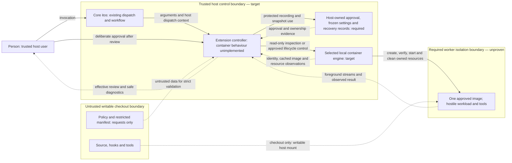
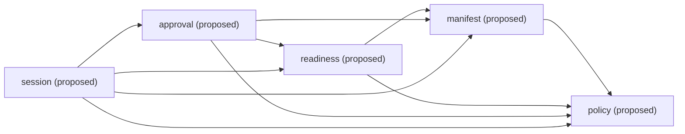

# Offline owned-run architecture

**Draft for the person's review — T-15, 2026-11-04.** This document proposes a
building-block decomposition. It implements no container command, approves no security
design and supplies no runtime evidence.

The [charter](../charter.md) selects the milestone from the binding
[pilot contract](../plans/container-pilot.md); the [plan](../../PLAN.md) records that
scope and its order. The [architecture and Slices rules](../architecture.md) and
[accepted T-14 decision](../decisions/0001-enforce-slice-and-engine-boundaries.md)
govern package boundaries. Read this draft with the
[T-11 lifecycle contract](../plans/offline-run-lifecycle.md), [CLI rules](../CLI.md),
[configuration rules](../CONFIG.md) and [working rules](../../AGENTS.md).
Those authorities take precedence over this proposed decomposition.

Throughout this document, **implemented** means existing foundation;
**required** means behaviour specified by those authorities but not built;
**proposed** means a responsibility or composition offered for review;
**blocked** identifies a person decision needed before dependent implementation;
and **deferred** means outside this milestone. A queued work item establishes neither
an implemented contract nor consent. Static document checks do not replace review.

## Goals

Run one coding workload and every tool it executes inside an explicitly approved,
offline worker for one checkout. The first milestone prioritizes isolation from the
host and all external networking, deliberate host-user approval, safe cleanup of owned
resources, and boundaries that can be tested independently and at runtime.

The required public operation is `itos container run -- <argv...>`: preserve explicit
arguments, run under an approved non-root identity, keep the checkout as the only host
filesystem mount, and remove owned ephemeral resources when foreground work ends.
Preserve checkout edits and isolated persistent project state.

Count, version and completion are implemented foundation and must remain intact.
Container commands and isolation are not implemented at drafting. Neither counting
tests nor a passing Go suite establish a sandbox. Linux amd64 with native Docker is
the target; support requires passing runtime evidence for that combination.

## Constraints

Assume hostile checkout code, arbitrary tool execution, dependency scripts and
prompt-injected instructions. Trust the host user, host controller, approved image
and selected local container engine. Containers do not defend against a host
administrator or kernel/container escape. The writable checkout is deliberately
exposed to destructive edits by its workload.

Hooks, Git configuration and agent instructions are workflow safeguards, not isolation.
After worker edits, checkout hooks, builds, plugins and dependency installs stay inside
the sandbox until the person reviews them. Host inspection must not execute checkout
code or repository-configured helpers.

The milestone permits no network access, credentials/accounts, ingress, extra host
mounts, remote engine or linked worktree. It provides no host-home, engine-socket or
SSH-agent forwarding, arbitrary engine flags or Docker-in-Docker. No missing input,
unsupported setting or failed check can select an unrestricted fallback.

Work follows ports and in-memory fakes; agents have no Docker socket and real-engine
scenarios run only in CI. Dependencies need a maintained library, a reason in the owning
behaviour spec and a pinned version. This draft selects no library or network service.

Preserve donvargax's attribution and the project's [AGPL-3.0 license](../../LICENSE) and
[contributors record](../../CONTRIBUTORS.md). Permission to reuse the owner's itos and
itos-template infrastructure does not relicense those projects or dependencies.
T-14 records the provenance and retained AGPL-3.0 notice for its adapted architecture
fixture separately; preserve those notices when reusing that work.

## Context and scope

Core itos retains work routing, commit rules and CI proof. Its existing extension seam
dispatches `itos container` to `itos-container`; dispatch alone supplies no isolation.
The proposed extension controller owns preparation, approval and session lifecycle.
The following is a **required target context**, not a deployed sandbox. Dashed arrows
carry data or observations; solid arrows carry control or deliberate consent.

The controller validates data crossing from the checkout; it must not execute that
data. The worker cannot access host approval/recovery records, host credentials or
engine control. The control arrow through the engine is trusted orchestration, not an
API exposed to the worker. The mount is intentionally writable, so edits return to the
checkout. No worker-to-network path exists in the required target.

[CLI dispatch context](../CLI.md#extension-dispatch-and-environment) belongs to the
host controller. `ITOS_ROOT` does not establish safe checkout identity; `ITOS_CONFIG`
names core configuration, not `itos-container.yaml`. Inheriting host environment at
dispatch does not authorize forwarding it to the worker.

Proxy egress, guard/proxy infrastructure, accounts, network Git, LAN publishing,
Compose services and other platforms are **deferred**. Do not create a guard, proxy
or session network merely to reproduce the online pilot's topology. Isolates, WASM,
a restricted shell and a capability broker remain deferred research. Later pilot
components and experiments require their own authorization and specifications.

## Solution strategy

Compose commands through shared engine domain/port contracts. Keep command handling,
domain decisions, I/O and rendering separate under T-14's existing enforcement:

- Commands use `internal/slices/<command>/{command,domain,port,<adapter>}`. Shared
  behaviour uses `internal/engine/<name>/{domain,port,<adapter>}`. Adapters are named
  siblings, never a generic `adapters` directory. Add no empty placeholder packages.
- Domains and ports perform no I/O and use the reviewed exact pure-package allowlist
  in [Slices](../architecture.md#slices) and [.golangci.yml](../../.golangci.yml).
  Domains use their own domain/port and permitted engine domain/port APIs. Ports own
  contract values and import only their own port subpackages and permitted engine
  ports, never domains.
- Commands are thin and perform no process, network or filesystem I/O. Adapters may
  use their own domain/port and permitted engine APIs. Only `cmd` binds concrete
  adapters. No slice imports another slice; no engine imports a slice.
- The generic UI imports no project package. `cmd` supplies each slice's failure
  classifier. Typed failures stay with their owning contracts; JSON, public rule IDs,
  exit codes and rendering stay outside domains and ports.
- These arrows also govern tests. Shared contracts and I/O-free stateful fakes live
  under the owning `port/porttest`; production never imports test support. Keep
  adapter-specific tests with their adapter and wiring tests at `cmd`.

The [T-14 decision and fixtures](../decisions/0001-enforce-slice-and-engine-boundaries.md)
are the enforcement reference, not a second allowlist maintained here. No new shared
package outside these roles or enforcement change is proposed.

Doctor, approve and run must reuse the same schemas, defaults, normalized contract
values and validation. They must agree on accepted/rejected inputs and effective
settings. Approval matching/canonicalization belongs to one shared responsibility,
not independent implementations in each command. A successful engine ping or a second,
permissive policy loader cannot establish readiness.

## Building-block view

The inventory separates existing packages from **proposed responsibility names**.
The proposed engines are a review hypothesis, not existing packages, Go signatures,
storage formats, algorithms or settled security designs.

| Building block | Status | Responsibility | Dependencies and contracts |
| --- | --- | --- | --- |
| `cmd/itos-container` | Implemented assembly root; container wiring proposed | Assemble commands, ports, concrete adapters and classifiers. Preserve version/completion infrastructure without turning it into container slices. | Existing count, generic UI and version leaf; future command and adapter wiring only as specified. |
| `internal/cli` | Implemented | Generic output/error rendering, flag rules and completion helpers. | No project imports; command model and classifiers supplied by `cmd`. |
| `internal/version` | Implemented leaf | Build/version information. | No container responsibility. |
| `internal/slices/count` | Implemented | Preserve counting behaviour and Files contract. | `command`, `domain`, `port`, `disk`, `input` siblings; `port/porttest` fake and shared contract are test support. Input's disk port is wired by `cmd`. |
| `internal/release` and inherited release tooling | Implemented, separate | Existing release mechanics and tests. | No sandbox support claim; `releasetest` remains test-only. |
| `internal/slices/init` | Proposed; examples required | Produce non-runnable policy/manifest examples without overwrite. | Specified policy/manifest example-generation contracts and a writing port; output paths still blocked. |
| `internal/slices/doctor` | Proposed; inspection required | Compose strict validation, readiness and approval inspection without resource mutation. | Policy, manifest, readiness and approval APIs; approval inspection does not move into readiness. |
| `internal/slices/approve` | Proposed; consent required | Present effective review/differences and record deliberate host-user consent. | Shared policy/manifest/readiness and approval contracts; never calls the doctor slice. |
| `internal/slices/run` | Proposed; T-11 contract required | Compose validated approval with foreground lifecycle. | Prerequisite engine contracts and session APIs; never calls approve to obtain consent. |
| `internal/slices/status` | Proposed; required for run recovery | Inspect owned state, policy identity, uncertainty and recovery information. | Session contracts; read-only, bounded inspection with safe diagnostics. |
| `internal/slices/stop` | Proposed; required for run recovery | Cancel an owned session or finish its cleanup. | Session contracts; identity revalidation and safe repeated removal. |
| `internal/slices/exec` | Deferred | Additional argv only during a live owned foreground session. | Future session contract; cannot extend lifetime or alter frozen permissions. |
| `internal/engine/policy` | Proposed | Strict offline policy values, schema/default/value validation and typed failures. | Own ports/adapters; supplies reusable policy contracts to all later engines. |
| `internal/engine/manifest` | Proposed | Restricted single-worker description and effective worker settings. | Policy domain/port contracts; own parsing ports/adapters. |
| `internal/engine/readiness` | Proposed | Read-only checkout, local-engine and cached-image observations. | Policy/manifest contracts; own inspection ports. No dependency on approval. |
| `internal/engine/approval` | Proposed | Effective review, differences, consent recording, matching/supersession and trusted frozen configuration. | Policy, manifest and readiness; own host-state ports. Security/storage details blocked. |
| `internal/engine/session` | Proposed | Lifecycle, ownership and recovery shared by run/status/stop. | Policy, manifest, readiness and approval prerequisites; own lifecycle/state ports. Security mechanisms blocked. |

Arrows below mean **proposed dependency on domain/port contracts**, not adapter imports
or runtime permission. Doctor composes readiness and approval inspection; readiness
never calls approval, so their composition creates no cycle.

The [registry](../../tasks/work-items.yaml) currently gives slice-1 through slice-4
planning requirements and no tagged scenarios. These are work-item slices, not four
commands and not the pilot's numbered milestone stages. The first three extend doctor;
the fourth adds approve and approval inspection to doctor. Their dependencies are
`T-14 -> slice-1 -> slice-2 -> slice-3`, with all three explicit prerequisites of slice-4.

| Work item | Prerequisites | Shared outputs and consumers |
| --- | --- | --- |
| T-14 — completed foundation | Existing counting example | Slice/engine boundaries, classifiers, fake/adapter contract pattern and enforcement fixtures for all later packages. |
| slice-1 — planned policy validation | T-14 | Specify schema, visible defaults, path/value rules and maintained parser pin. Introduce reusable policy values, typed diagnostic data, port contracts and synthetic valid/invalid syntax/default/value fixtures. Doctor exposes validation; manifest, readiness, approval and later run reuse it. |
| slice-2 — planned worker manifest | slice-1 | Specify discovery, JSON-with-comments, fields, reserved environment, metadata and hooks. Introduce manifest schema/effective worker values, parser pin, contracts and synthetic field/interpolation/metadata/hook fixtures. Reuse policy fixtures; doctor, readiness, approval and run reuse the resulting validation. |
| slice-3 — planned readiness | slice-2, consuming slice-1 policy too | Specify safe checkout/host-user/local-engine identity and inspect cached digest, architecture, compatibility and metadata through shared ports. Select the maintained engine library and pin in this spec. Introduce synthetic identity/substitution, unsupported-layout and image-observation fixtures for doctor, approval and run. A ping alone is insufficient. |
| slice-4 — planned approval | slice-1, slice-2 and slice-3 explicitly | Reuse validated settings/identity for effective review, differences, consent, matching/supersession and protected approval/snapshot storage. Introduce contracts and synthetic changed-settings, equal-basename projects, supersession and protected-state fixtures. Doctor gains approval inspection; approve records consent; run consumes validated frozen settings. |
| Later init and run/status/stop behaviour specs — not new registry items here | Settled prerequisite contracts; T-11 planning cases; person decisions below; engine-test tier for runtime cases | Specify example generation and lifecycle/recovery behaviour before implementation. Run's recovery promise requires status/stop contracts, not a printed command that does not exist. Session fixtures cover phases, uncertain create, cleanup, loss and independent projects. |

Each owning engine introduces reusable validation and port contracts with its work item.
Shared contract suites under its `port/porttest` run unchanged against the in-memory
fake and every adapter; real-engine adapter runs are CI-only. Later consumers reuse
those suites, normalized values, typed failures and synthetic fixtures without importing
a sibling slice. Command classifiers translate failure data into public presentation.
No table entry selects policy keys, canonical bytes, identity fingerprints or storage
fields; those belong to approved sibling specs. If they advance, cite their settled
decisions here and report any authority conflict rather than resolve it silently.

Ordinary doctor is read-only inspection. The pilot separately proposes
`doctor --probe` for explicit bounded disposable runtime probes with trusted material,
no agent, no real credentials and no checkout scripts. It is not ordinary readiness,
has no implementation here and grants agents no local engine access.

## Runtime view

All flows in this section are **required but unimplemented**. T-11 owns the detailed
[argument and JSON choices](../plans/offline-run-lifecycle.md#arguments-and-json),
[startup ordering](../plans/offline-run-lifecycle.md#ownership-and-startup) and
[result precedence](../plans/offline-run-lifecycle.md#workload-exits).

| Flow | Required success path | Refusal or partial failure; blocking decisions |
| --- | --- | --- |
| Init | Generate specified non-runnable examples without overwriting existing files. | Existing files remain intact; output paths and example content await policy/manifest and init specs. No runnable permissive default. |
| Doctor | Strictly validate policy/manifest, inspect checkout/local engine/cached image, then compose approval inspection and safe diagnostics. | Reject invalid data, unsupported layouts, remote engine or missing/incompatible content. No repair by execution, acquisition or fallback. Identity, metadata and approval decisions block the corresponding inspection. |
| Approve | Resolve the same effective values/defaults and identity, display differences, obtain deliberate host-user consent, record protected approval. | Invalid requests/readiness prevent recording; no consent means no approval. Canonicalization, matching, supersession, consent interface and protected storage remain blocked on slice-4/person decisions. |

Init, ordinary doctor and approve execute no checkout code, install no hooks, log in
to no account and pull/build/start no images or sessions. Approval cannot launch work.

### Foreground run and its failure paths

1. **Preflight, preparing.** Require nonempty executable argv after `--`. Preserve all
   subsequent argument boundaries without an implicit shell or injected agent flags.
   T-11 requires missing/empty-command refusal and wrapper/inherited JSON refusal
   before resources; a workload `--json` remains a literal argument. Then reuse strict
   policy/manifest validation, safe checkout/local-engine identity, cached approved
   digest/architecture/metadata and approval inspection. Missing, invalid, mismatched
   or superseded approval refuses before resource creation. **Blocked** on slice-1
   through slice-4's exact validation, identity, image and approval contracts.
2. **Frozen settings, preparing.** Capture validated effective configuration in trusted
   session material beyond worker control. Startup/setup use that snapshot. Checkout
   edits or later approval cannot widen the session; new permissions require a new
   approved run after stopping the old one. **Blocked** on slice-4's atomic snapshot
   and protected storage semantics.
3. **Create and own, preparing.** Create only necessary resources without running a
   worker process. Durably record concrete IDs and ownership before any image
   entrypoint, setup or workload instruction. A failed record write prevents execution
   and enters bounded cleanup/recovery. **Blocked — Crash-safe ownership:** create
   can succeed while its response or durable record is lost. No name/label alone
   proves ownership; uncertain create must not launch or trigger blind duplicate creation.
4. **Verify, then ready.** Verify every required boundary before any worker instruction.
   Unverifiable isolation refuses later execution and enters cleanup/recovery.
   **Blocked — Offline boundary, Manifest and writable state, Image readiness:**
   first-process enforcement, identity/storage mapping and verification need decisions
   and runtime proof. Only then may selected supported setup run inside the boundary.
   Failed setup prevents subsequent setup and foreground launch and starts cleanup.
5. **Launch, running.** After successful setup, attach to the explicit foreground argv
   under frozen settings. Launch/attach uncertainty requires reconciliation, not a
   fabricated exit. Cancellation stops later phases and accounts for in-flight work.
   **Blocked — Resource and wait budgets; Cancellation and controller loss:** calls,
   attach, signal handling and unknown outcomes need their settled contracts.
6. **Finish, stopping.** Observed primary exit ends the session and begins bounded
   owned cleanup. Confirm removal/absence before claiming stopped. Incomplete cleanup
   retains failed-state recovery information. **Blocked — Safe recovery:** durable
   records, concurrent mutation, redaction and status/stop interfaces require specs.

### State and result interpretation

These are T-11's interface meanings, not a storage schema or proof of a transition.

| State | Meaning and allowed progress |
| --- | --- |
| preparing | Preflight, frozen settings and resource creation/verification; foreground not launched. Success reaches ready. Failure/cancellation enters stopping when cleanup is needed, otherwise records failure. |
| ready | Boundaries verified and ownership durable; supported setup may run. Successful setup permits running; setup failure/cancellation enters stopping. |
| running | Foreground launched under frozen settings. Observed exit/cancellation enters stopping; controller/engine loss is not observed termination. |
| stopping | Bounded owned cleanup, including partial startup and already stopped workers. Confirmed completion reaches stopped; incomplete cleanup reaches failed. |
| stopped | Required ephemeral cleanup confirmed, including recorded resources confirmed absent. Workload result and edits/project state remain; no restart authorized. |
| failed | Startup/setup/controller failure or incomplete cleanup. Report present/uncertain resources separately; later authorized stop may resume stopping. Never imply removal from this state name. |

Preserve an observed nonzero workload exit even when cleanup fails, with a separate
cleanup diagnostic and recovery reference. If the workload exits zero but required
cleanup fails, return a nonzero wrapper failure classified by its cause. T-11 retains
the CLI wrapper meanings, rather than importing helper-tool codes or treating every
cleanup error as transient. Return zero only with known successful work and cleanup;
cancellation mapping still needs its person decision.

Pre-launch refusals have no child status. Lost engine/controller observations never
become invented workload success or failure: a surviving controller reports its
classified nonzero failure and an unknown child outcome; a dead controller cannot
return a result or run cleanup. Signal delivery is not termination evidence.

### Recovery

Status inspects owned sessions after partial startup, lost create response, cancellation,
engine loss or controller interruption. Stop cancels a live owned session or resumes
cleanup using revalidated trusted ownership and concrete resource identity. Refuse
wrong-user, foreign, mismatched or ambiguous resources; labels/names only corroborate
ownership. Confirmed-absent recorded resources are safe on repeated stop; an unreachable
engine does not establish absence. Never prune unrelated resources or remove shared
images, checkout edits or persistent project state.

Retain recovery information until cleanup is confirmed. Report the owned session ID
and an exact safely rendered `itos container stop` retry containing that ID, as
[T-11 requires](../plans/offline-run-lifecycle.md#cleanup-and-recovery). Status/stop must
be specified and built before run can promise an executable recovery path.
Concurrent run/status/stop, uncertain creation and protected record semantics remain
**blocked — Crash-safe ownership; Safe recovery**.

Isolation must remain closed through loss until removal is confirmed. Whether/how a
worker stops when its controller dies remains **blocked — Cancellation and controller
loss; Offline boundary**; no watchdog, lease or instantaneous cleanup is assumed.
There is no detached lifetime or unattended restart. Preserve the future exec invariant:
primary exit refuses new exec and tears down active exec commands without extending
lifetime. Exec implementation remains deferred.

## Deployment view

This is a **required target placement**, not a working deployment. The selected host is
Linux amd64 with native Docker, subject to runtime evidence. No engine option or flag
is selected here as sufficient enforcement.

| Location | Required contents and access | Status or decision boundary |
| --- | --- | --- |
| Trusted host | Person, core itos dispatch and extension controller; local engine control available only to trusted orchestration. | Dispatch/foundation exists; container controller behaviour is proposed. Agents receive no socket. |
| Host-owned state outside checkout | Approval records, trusted frozen configuration and recovery records. | Worker cannot read or write them. Exact protection, identity, layout and persistence are blocked on approval/recovery decisions. |
| Untrusted checkout | Source, request policy and restricted manifest; writable by the worker. | Its only host filesystem mount. Safe source/target resolution and substitution handling remain blocked. |
| Local engine image store | Explicitly approved cached image content with verified digest, architecture, compatibility and metadata. | Person prepares images explicitly; control commands inspect, never auto-pull, build or substitute. Provenance/acquisition rules remain blocked. |
| Worker | Approved non-root identity, read-only image root, `no-new-privileges`, no administrative capabilities, sudo, host namespaces, engine/SSH-agent sockets or host credentials. | Required from the first instruction, including entrypoint/setup; enforcement and identity mapping need runtime proof. |
| Container-managed storage | Isolated persistent project state and explicit container-owned temporary storage. | No host `/tmp` or extra host bind mount, host-wide chown or shared writable cache between unrelated projects. Mapping and safe lifecycle remain blocked. |
| Worker network boundary | No external network path or published port from the first instruction. | Offline enforcement remains a person decision; no proxy, guard or session network is introduced here. |
| Disposable CI runtime environment | Prepared trusted test images, disposable checkouts/state, controlled probes and independent engine observations. | Required future engine-test tier; distinct from socket-free agent work. No valuable credentials or checkout-controlled host setup. |

Engine access in CI does not extend to the coding agent. Local domain/contract tests
use I/O-free fakes. Portability builds and tests on another host do not validate this
placement or authorize a new supported engine/architecture combination.

## Cross-cutting concepts

**Strict data and shared resolution.** Follow [CONFIG's data rules](../CONFIG.md#data-and-validation)
recursively, including mappings inside lists: reject duplicate, unknown and non-string
keys, multiple documents, anchors, aliases, merge keys and non-JSON/custom tags. The
permitted non-specific `!` spelling and JSON-type tags cannot construct objects or
expand anything. Validate every value against the specified schema before use; neither
empty/missing data, ignored `x-` keys nor an inferred version is acceptable. The
restricted manifest's exact JSON-with-comments syntax needs its own reviewed parser
and field contract, with no host interpolation or Dev Containers CLI fallback.

**Visible defaults and denial before effects.** Shared resolution supplies documented
defaults and typed key-path/index diagnostic data to doctor, approve and run. Defaults
grant no permission. Review effective settings and changes before consent; reject
invalid or unsupported requests before any session creation. Representation guidance
for paths does not settle safe identity or discovery. Init's examples remain non-runnable
and deterministic, preserve read-back meaning, and never overwrite existing files.

**Approval and ownership are distinct.** Approval authorizes reviewed effective settings;
it is not permission to mutate any resource with a similar name. Frozen configuration
protects startup against request edits; durable ownership authorizes session recovery.
Keep approval, canonicalization, identity, storage, metadata and hooks open until their
own specs and person decisions settle them. Record ownership before execution, and
retain uncertainty when observations are lost.

**Diagnostics and streaming.** Public rule IDs, JSON and exit mapping belong outside
domains/ports under the [CLI output contract](../CLI.md#output-and-the-contract-with-scripts).
Controller diagnostics/status/recovery must exclude raw argv, inherited host
environment, workload output and synthetic sensitive markers. Report safe typed
problems and recovery identity. Trusted effective snapshots are distinct from recovery
metadata; deliberate foreground streams are distinct from controller logs. There is
no claim to redact arbitrary workload output or permission to copy it into recovery.

**Bounded operations.** T-11 requires finite per-call and total startup, teardown and
recovery budgets; retries/progress cannot reset totals. Setup and attach establishment
belong within startup. Timeout still needs separately bounded cleanup and uncertain
operation reconciliation. Foreground waiting supplies no invented workload lifetime
limit. Numeric limits, signal escalation, repeated cancellation, stream backpressure
and loss outcomes remain person decisions.

**Dependencies and platforms.** Owning behaviour specs choose maintained libraries,
record reasons and pin versions before adapters are implemented. T-14's tooling YAML
dependency does not select the runtime policy parser. Pass the OS as a value to
OS-dependent logic; do not branch on `runtime.GOOS` inside it. Build tags hold only an
unavailable OS call, with no mutation site, under the existing architecture rules.
Fakes perform no I/O and runtime scenarios remain CI-only.

## Decisions

| Authority or proposal | Standing | Effect on this draft |
| --- | --- | --- |
| [Charter](../charter.md) and [pilot contract](../plans/container-pilot.md) | Binding scope and required boundary | The charter selects the offline milestone; later pilot components remain deferred. This draft changes neither. |
| [T-14 accepted decision](../decisions/0001-enforce-slice-and-engine-boundaries.md) and [Slices](../architecture.md#slices) | Accepted package/enforcement design | Reuse the existing arrows, exact allowlist and fixtures. No competing layout or enforcement proposal. |
| [T-11 lifecycle](../plans/offline-run-lifecycle.md) | Recorded interface choices and required future cases | Preserve argument/JSON refusals, state meanings, result precedence and recovery obligations; its security questions remain open. |
| Policy/manifest/readiness/approval/session decomposition | Proposed for the person's review | Responsibility names and dependency directions only; no signatures, storage schema or accepted security ADR. |
| [slice-1 through slice-4](../../tasks/work-items.yaml) | Planned work, not consent or implementation | Own the future exact contracts and library choices. Reuse settled specs as they arrive. |

The person reviews this draft. Passing heading/link/table checks is neither that review
nor authorization to implement a blocked design. The charter's drift rule applies:
when implementation departs from an arc42 section, record a decision in
`docs/decisions/` naming the section it overrides and why, and update that section in
the same pull request. Report drift elsewhere to the coordinator. Do not quietly
diverge, rewrite Slices or turn an unresolved security question into an accepted ADR.

## Quality requirements

Pilot AC labels are traceability labels, not scenario IDs or claims of passing tests.
The table maps required evidence to the current gates and the work still absent.

| Requirement | Evidence and gate | Status or gap |
| --- | --- | --- |
| Strict policy and restricted manifest | Future slice-1/2 black-box acceptance/refusal cases plus shared validation/port contracts; AC-01, AC-39/40/41 offline scope. | No loader/scenario proof yet. AC-39's later guard/proxy wording does not add one to this milestone. |
| Explicit matching approval and frozen settings | Slice-4 cases and shared contracts; T-11 missing/mismatched/superseded and frozen-settings cases; AC-02/03/41. | Consent, identity and storage decisions pending; no approval implementation. |
| Preparation executes no checkout code | Synthetic hooks/plugins/host markers with positive controls; AC-04 and T-11 strict-input cases. | Future init/doctor/approve evidence, not implied by a parser or Go tests. |
| Safe checkout, local engine and approved cached image | Slice-3 contracts and CI observations; AC-05/38; T-11 identity, cached-image and hidden-metadata cases. | No readiness implementation; absent images must refuse without acquisition. |
| Host isolation, mount and non-root writable boundary | Independent CI probes for allowed writes and denied host/root/privilege access; AC-07/08/25 and T-11 non-root case. | No runtime proof. Protected online guard material from AC-08 remains deferred. |
| Offline isolation from first instruction and through loss | Trusted working controls plus worker IPv4/IPv6, gateway/private-route and DNS denial; AC-10/11/37 offline portions and T-11 loss/setup cases. | Enforcement decision and engine tier block proof; engine flags and broken controls cannot pass it. |
| Literal argv and setup ordering | T-11 argv, explicit-shell and setup-failure cases; AC-21/42. Local argument refusals plus fake sequencing; actual execution only in CI. | No run implementation. Unknown-command errors are not the specified refusal. |
| Durable ownership, bounded cleanup and independent projects | T-11 write-failure, uncertain-create, cancellation, repeated/foreign stop and two-project cases; AC-06/22/23/28 offline portions. | Session and status/stop specs, ownership/recovery and wait/signal decisions pending. |
| Safe diagnostics and honest outcomes | Synthetic marker exclusion and unknown/zero/nonzero outcome cases; AC-22/36 offline portions, with foreground streams captured separately. | No controller/recovery implementation; no credential-scan claim. |
| Package dependency boundaries | Depguard and structural `architecture-check`; compile-first [fixtures](../../tools/testdata/architecture) for enforcement-input changes. | Implemented T-14 gates, not isolation proof. Ordinary code takes the cheap structural check. |
| Domain correctness and contract fidelity | Shared contracts against each fake/adapter; unit/property tests and [per-domain coverage](../../tools/bin/domain-coverage) with an 80% floor, including nested domains. | Counting foundation exists; future engines need their own evidence. Real-engine adapters run only in CI. |
| Fresh changed-code evidence | T-13 `proof.code` in [itos.yaml](../../itos.yaml): seeded mutation sample and measured changed-line coverage in CI. | Applies to changed production Go paths, not this document. Not a full foundation baseline or runtime sandbox proof. |
| Architecture draft consistency | T-15's [ledger checks](../../tasks/phase-1.yaml) require the twelve headings, source links and four table headers; semantic review checks flows, dependencies, status and links. | Static presence cannot establish design correctness or person approval. |

### Existing check tiers

[itos.yaml](../../itos.yaml) selects the prose plan for Markdown, docs and task paths:
configuration validation, document caps and required-file presence, alongside applicable
task checks. The [pre-commit hook](../../tools/hooks/pre-commit) skips code lint and
vulnerability work for its prose/data-only selection. For code it runs structural
architecture checks, fixtures only when staged enforcement inputs change, pinned lint
and the Go vulnerability check. Vulnerability checking is not credential scanning.

The normal CI plan retains formatting, structural checks, enforcement-change fixture
selection, build, vet, module verify/tidy, smoke integrity, lint, vulnerability checks,
unit/property tests, domain coverage and selected scenarios. The
[workflow](../../.github/workflows/ci.yml) runs automatic Linux checks and the full
test suite on main pushes and non-draft pull requests; draft PRs skip those jobs.
Manual dispatch also runs Linux and adds macOS/Windows portability tests. The separate
Linux full-suite job is not removed by the itos prose selection. Neither portability
tests nor architecture fixtures establish runtime container support.

CI alone runs pinned itos-cc for fresh changed-code proof over the judged range: up to
ten mutation sites across changed functions, with core itos supplying the same `{base}`
to `--since` and `--seed`, plus measured coverage of added/changed lines, including
functions without mutation sites. The same base and eligible sites give the same draw;
changing the candidate set can change it. Tests must kill survivors and cover uncovered
lines. Never redraw to escape failure or reshape code to remove sites. Only truly
equivalent mutants may have reasoned exceptions for the person to review; uncovered
code never receives an exception. Agents run no local mutation proof and commit no
generated mutation/coverage evidence. This document touches no `proof.code` path.

### Future behaviour evidence

Specify behaviour before building it. Scenarios in `features/` use `test` commits with
their item, never `docs` commits. Implementers commit step definitions red first while
scenarios remain `@wip`, run with `@wip` removed at the permitted tier, and observe each
behaviour assertion fail before implementation; then implement and prove green.
Undefined steps, setup failures and today's unknown-command diagnostic are not proof.
Non-engine evidence is local; all real-engine evidence is CI-only.

The engine-test tier is tracked as [T-16](../../tasks/work-items.yaml), promoted from
`p1-engine-scenario-tier`. It must supply an explicit tag, switch and Linux job before
engine cases become executable. `@wip` alone is not an engine-access boundary. T-15 adds
no cases or runtime evidence and changes no gates. Agents commit and stop; only the
coordinating loop pushes, verifies the actual pushed head and its required proof, and
closes the item.

## Risks and open questions

The following carries the pilot's open categories and
[T-11's security decisions](../plans/offline-run-lifecycle.md#security-decisions)
forward. The person settles security choices through the responsible specs. An item
name is ownership of specification work, not evidence of consent. These questions
block dependent implementation, not writing or reviewing this draft.

| Open question | Decision owner | Blocks |
| --- | --- | --- |
| Exact offline policy schema, version, defaults, path rules and parser | Person through slice-1 spec | Policy contracts and valid effective inputs for every later engine; no key catalog or default chosen here. |
| Manifest discovery/output paths, JSON-with-comments syntax, fields, reserved environment, metadata and hook syntax/order/failure/repetition | Person through slice-2; init spec for examples/output | Manifest validation, init generation, approval review and ready-to-setup/launch. No hidden metadata command or environment grant may slip through. |
| Safe checkout/host-user/local-engine identity, symlinks and substitution | Person through slice-3, consumed by slice-4/session specs | Readiness, approval binding, mount source and ownership checks; basenames or dispatch roots alone cannot identify a project. |
| Approval canonicalization/fingerprint, matching/supersession, explicit consent and protected approval/frozen-snapshot storage | Person through slice-4 | Recording consent, pre-creation approval check and atomic frozen settings; no hash, representation or storage path selected here. |
| Approved worker versions/digests, provenance, architecture/compatibility, image distribution and person-operated acquisition/update verification | Person through slice-3 and image preparation specs, consumed by slice-4 | Cached-image preflight and every runtime fixture. No automatic pull/build/substitution; guard-image choices remain deferred. |
| Offline enforcement before the first process, including IPv4/IPv6, gateway/private routes, DNS and no publishing; closure through setup/loss | Person through offline run/isolation spec | Boundary verification and ready state. No engine flag, topology or proxy workaround selected here. |
| Approved non-root identity and writable checkout/project-state/temp mapping | Person through slice-2/readiness and run/state specs | Manifest resolution, deployment and successful allowed writes without root, extra mounts or host-wide chown. |
| Crash-safe durable ownership and create accepted with response/record lost | Person through session/run/recovery specs | Resource creation, any entrypoint execution and later cleanup. No in-memory-only assumption, journal or name/label deletion rule chosen. |
| Resource limits, per-call/total startup/teardown/recovery budgets, retry accounting, setup/attach and backpressure | Person through run/status/stop specs | Bounded transitions and timeout classification. No numeric limits or maximum workload duration invented. |
| Cancellation, signal targets/forwarding/escalation/grace, repeated interruption, signal-derived outcomes and controller loss | Person through run/status/stop specs for the target platform | Cancellation/loss transitions and result mappings without an observed nonzero child exit. A dead controller cannot clean up; whether/how its worker stops needs a decision. |
| Safe recovery storage/fields, concurrent run/status/stop, mutation-time ownership checks, safe IDs/redaction and unknown workload outcomes | Person through session/status/stop specs, reusing slice-3/4 identity/approval | Failed-state diagnostics, actionable retry and confirmed cleanup. Unknown outcomes must stay unknown; recovery metadata is not the effective snapshot. |
| Guard/proxy topology and fail-closed addon/runtime failures | Person through later approved-egress experiment/spec — deferred | Online egress only; not a reason to add a guard or session network to offline run. |
| TLS inspection/passthrough handshake guarantees, unverifiable clients, trust and downgrade refusal | Person through later proxy/TLS spec — deferred | Online destination modes and truthful authority guarantees; no mode chosen here. |
| Minimal auth provisioning/refresh, account management, callbacks, revocation/deletion and CA/SSH-key rotation | Person through later credential lifecycle specs and explicit live-account consent — deferred | Accounts, network Git and credential-bearing work; no generic host shell/HTTP bridge. |
| Pinned client/tool versions, download destinations, redirect chains and TLS compatibility | Person through later worker/download specs — deferred | Online dependency/tool workflows; installer metadata cannot grant destinations. |
| Failed Actions-log redirects: narrow destination approval or reviewed run/artifact-specific retrieval | Person through later CI-log retrieval spec — deferred | Online failed-CI inspection; generic host fetching remains excluded. |
| Streaming/client performance budgets and measurements | Person through later compatibility/performance experiments — deferred | Online performance claims; no presumed proxy language advantage or numerical target. Offline resource/wait budgets remain required above. |
| Initially validated OS/engine/architecture matrix beyond the target and LAN binding constraints | Person through later platform/ingress specs — deferred | Additional support and publishing claims. Linux amd64/native Docker still needs its own runtime proof; no LAN exposure in this milestone. |
| Compose service/network/mount contract and alternative isolation research | Person under a later charter-approved scope — deferred | Compose, isolates, WASM, restricted shell and broker work; no implementation from this draft. |

The main design risk is treating shared requirements or diagrams as completed security
work. Other concrete failure modes are drift between command loaders, readiness/approval
cycles, reuse of mutable checkout data after approval, untracked resources after create
loss, and confusing unavailable observations with successful work or cleanup. The
proposed shared ownership of contracts addresses decomposition; only approved specs,
tests and runtime evidence can establish the required behaviour.

## Glossary

| Term | Meaning here |
| --- | --- |
| Work-item slice | A registry increment such as slice-1; several increments may extend one command. |
| Command slice | One command's vertical package under `internal/slices/<command>` with its domain/ports/named adapters. |
| Pilot milestone stage | A numbered phase of the pilot's implementation sequence; the charter selects stages 1–3, not three work items or commands. |
| Shared engine package | A proposed reusable domain/port/adapter responsibility under `internal/engine/<name>`. It is not a container runtime. |
| Container engine | The selected trusted local runtime controlling actual images and resources; native Docker is the initial target. |
| Request | Untrusted checkout policy or manifest data. Valid syntax/effective values do not constitute consent. |
| Approval | Deliberate host-user authorization bound to reviewed effective settings and trusted identity; stored outside the checkout. |
| Frozen configuration | Trusted effective settings used for one session, unaffected by later request edits or approval. Exact representation belongs to slice-4. |
| Recovery metadata | Protected ownership, lifecycle/cleanup and uncertainty information sufficient for later inspection/removal; excludes raw argv/environment/output. Distinct from frozen configuration. |
| Checkout identity | The safely resolved checkout and its relevant identity, not a folder basename or unchecked path. Rules remain open. |
| Project identity | The approved separation of a checkout's user/engine context and persistent state from another project's; exact binding remains open. |
| Session identity | One owned foreground run and its concrete resources/recovery reference, not authority to adopt similarly labelled resources. |
| Persistent state | Isolated project storage and checkout edits that survive session cleanup; credentials are outside this milestone. |
| Ephemeral state | Owned worker/session temporary resources removed or confirmed absent during cleanup. |
| Fake/contract evidence | Tests of decisions and agreed port behaviour using I/O-free in-memory implementations and adapter contract suites; not runtime isolation proof. |
| Real-engine proof | CI observations of actual resources, first-instruction boundaries, signals and cleanup with working independent controls, for a recorded host/engine/image combination. |
