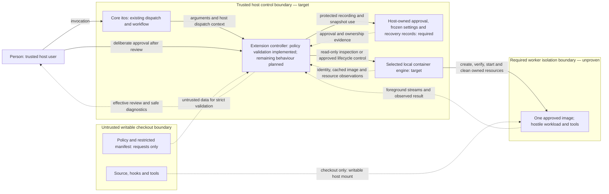
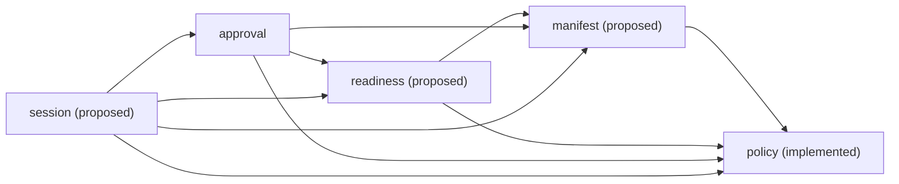

# Offline owned-run architecture

**Current design — accepted by the person on 2026-11-04; reconciled by T-19.**
This architecture is a hypothesis under the charter, not runtime isolation evidence.
Acceptance did not settle every security mechanism. The decisions below distinguish
what landed, what the person and coordinator settled, and what still needs specification.

The [charter](../charter.md) selects the milestone from the binding
[pilot contract](../plans/container-pilot.md); the [plan](../../PLAN.md) records that
scope and its order. The [architecture and Slices rules](../architecture.md) and
[accepted T-14 decision](../decisions/0001-enforce-slice-and-engine-boundaries.md)
govern package boundaries. Read this design with the
[T-11 lifecycle contract](../plans/offline-run-lifecycle.md), [CLI rules](../CLI.md),
[configuration rules](../CONFIG.md) and [working rules](../../AGENTS.md).
Those authorities bound this decomposition. The person's later milestone decisions
recorded in [T-19](../../tasks/phase-1.yaml) and revised A1 in
[q-2](../../tasks/asks.yaml) settle the choices identified below; broader pilot state
and hooks are later scope. This document does not expand the charter.

Throughout this document, **implemented** means present in this checkout;
**required** means behaviour specified by those authorities but not built;
**proposed** means an unbuilt responsibility within the accepted design hypothesis;
**blocked** identifies a person decision needed before dependent implementation;
and **deferred** means outside this milestone. A queued work item establishes neither
an implemented contract nor consent. Static document checks do not replace review.

## Goals

Run one coding workload and every tool it executes inside an explicitly approved,
offline worker for one checkout. The first milestone prioritizes isolation from the
host and all external networking, deliberate host-user approval, safe cleanup of owned
resources, and boundaries that can be tested independently and at runtime.

The required public operation is `itos container run -- <argv...>`: preserve explicit
arguments, run under an approved non-root identity, keep the checkout as the only host
filesystem mount, and remove owned ephemeral resources when foreground work ends.
Preserve checkout edits. A2 selects ephemeral tmpfs and excludes persistent worker
volumes, caches and profiles this milestone. Host approval, frozen configuration and
recovery records persist separately, outside the checkout. Init is deferred and no
lifecycle hooks run in this milestone.

Count, version and completion are implemented foundation and must remain intact.
Policy validation in doctor, including `doctor --policy-only`, is implemented by
slice-1 and bounded by slice-5. Its explicit policy scope does not establish manifest,
host readiness or approval inspection by that file-only mode. Ordinary doctor now
composes readiness and approval; slice-4 implements explicit approval and frozen input.
Run validates invocation and approval; offline startup and isolation remain unimplemented.
Neither policy/counting tests nor a passing Go suite establish a sandbox. Linux amd64
with native Docker is the target; support requires runtime evidence for that combination.

## Constraints

Assume hostile checkout code, arbitrary tool execution, dependency scripts and
prompt-injected instructions. Trust the host user, host controller, approved image
and selected local container engine. Containers do not defend against a host
administrator or kernel/container escape. The writable checkout is deliberately
exposed to destructive edits by its workload.

Hooks, Git configuration and agent instructions are workflow safeguards, not isolation.
After worker edits, checkout hooks, builds, plugins and dependency installs stay inside
the sandbox until the person reviews them. Host inspection must not execute checkout
code or repository-configured helpers.

The milestone permits no network access, credentials/accounts, ingress, extra host
mounts, remote engine or linked worktree. It provides no host-home, engine-socket or
SSH-agent forwarding, arbitrary engine flags or Docker-in-Docker. No missing input,
unsupported setting or failed check can select an unrestricted fallback.

Work follows ports and in-memory fakes; agents have no Docker socket and real-engine
scenarios run only in CI. Dependencies need a maintained library, a reason in the owning
behaviour spec and a pinned version. This update records existing parser choices and
adds no library or network service.

Preserve donvargax's attribution and the project's [AGPL-3.0 license](../../LICENSE) and
[contributors record](../../CONTRIBUTORS.md). Permission to reuse the owner's itos and
itos-template infrastructure does not relicense those projects or dependencies.
T-14 records the provenance and retained AGPL-3.0 notice for its adapted architecture
fixture separately; preserve those notices when reusing that work.

## Context and scope

Core itos retains work routing, commit rules and CI proof. Its existing extension seam
dispatches `itos container` to `itos-container`; dispatch alone supplies no isolation.
The extension controller owns validation, approval and session lifecycle.
The following is a **required target context**, not a deployed sandbox. Dashed arrows
carry data or observations; solid arrows carry control or deliberate consent.

The controller validates data crossing from the checkout; it must not execute that
data. The worker cannot access host approval/recovery records, host credentials or
engine control. The control arrow through the engine is trusted orchestration, not an
API exposed to the worker. The mount is intentionally writable, so edits return to the
checkout. No worker-to-network path exists in the required target.

[CLI dispatch context](../CLI.md#extension-dispatch-and-environment) belongs to the
host controller. `ITOS_ROOT` does not establish safe checkout identity; `ITOS_CONFIG`
names core configuration, not `itos-container.yaml`. Inheriting host environment at
dispatch does not authorize forwarding it to the worker.

Proxy egress, guard/proxy infrastructure, accounts, network Git, LAN publishing,
Compose services and other platforms are **deferred**. Do not create a guard, proxy
or session network merely to reproduce the online pilot's topology. Init, lifecycle
hooks and persistent worker project state are also deferred. Isolates, WASM,
a restricted shell and a capability broker remain deferred research. Later pilot
components and experiments require their own authorization and specifications.

## Solution strategy

Compose commands through shared engine domain/port contracts. Keep command handling,
domain decisions, I/O and rendering separate under T-14's existing enforcement:

- Commands use `internal/slices/<command>/{command,domain,port,<adapter>}`. Shared
  behaviour uses `internal/engine/<name>/{domain,port,<adapter>}`. Adapters are named
  siblings, never a generic `adapters` directory. Add no empty placeholder packages.
- Domains and ports perform no I/O and use the reviewed exact pure-package allowlist
  in [Slices](../architecture.md#slices) and [.golangci.yml](../../.golangci.yml).
  Domains use their own domain/port and permitted engine domain/port APIs. Ports own
  contract values and import only their own port subpackages and permitted engine
  ports, never domains.
- Commands are thin and perform no process, network or filesystem I/O. Adapters may
  use their own domain/port and permitted engine APIs. Only `cmd` binds concrete
  adapters. No slice imports another slice; no engine imports a slice.
- The generic UI imports no project package. `cmd` supplies each slice's failure
  classifier. Typed failures stay with their owning contracts; JSON, public rule IDs,
  exit codes and rendering stay outside domains and ports.
- These arrows also govern tests. Shared contracts and I/O-free stateful fakes live
  under the owning `port/porttest`; production never imports test support. Keep
  adapter-specific tests with their adapter and wiring tests at `cmd`.

The [T-14 decision and fixtures](../decisions/0001-enforce-slice-and-engine-boundaries.md)
are the enforcement reference, not a second allowlist maintained here. No new shared
package outside these roles or enforcement change is proposed.

Doctor, approve and run must reuse the same schemas, defaults, normalized contract
values and validation. They must agree on accepted/rejected inputs and effective
settings. Approval matching/canonicalization belongs to one shared responsibility,
not independent implementations in each command. A successful engine ping or a second,
permissive policy loader cannot establish readiness.

## Building-block view

The inventory separates existing packages from **proposed responsibility names**.
Unbuilt engines remain a design hypothesis, not existing packages, Go signatures or
record schemas. Settled choices constrain them without proving their implementation.

| Building block | Status | Responsibility | Dependencies and contracts |
| --- | --- | --- | --- |
| `cmd/itos-container` | Implemented assembly root, including policy-only doctor and run refusals | Assemble commands, ports, concrete adapters and classifiers. Preserve version/completion infrastructure without turning it into container slices. | Existing count, doctor, run, policy, generic UI and version leaf; remaining wiring only as specified. |
| `internal/cli` | Implemented | Generic output/error rendering, flag rules and completion helpers. | No project imports; command model and classifiers supplied by `cmd`. |
| `internal/version` | Implemented leaf | Build/version information. | No container responsibility. |
| `internal/slices/count` | Implemented | Preserve counting behaviour and Files contract. | `command`, `domain`, `port`, `disk`, `input` siblings; `port/porttest` fake and shared contract are test support. Input's disk port is wired by `cmd`. |
| `internal/release` and inherited release tooling | Implemented, separate | Existing release mechanics and tests. | No sandbox support claim; `releasetest` remains test-only. |
| `internal/slices/init` | Deferred | Non-runnable example generation belongs to later scope. | No init implementation authorized this milestone. |
| `internal/slices/doctor` | Implemented through slice-4 | File-only validation remains separate; ordinary doctor inspects checkout, engine, image and approval and prints the exact candidate fingerprint. | Shared readiness and approval ports; no state writes or checkout execution. |
| `internal/slices/approve` | Implemented by slice-4 | Show effective settings/differences and ask y/N at a terminal; offer optional exact-fingerprint non-interactive approval. | Shared policy/manifest/readiness and approval contracts; no prompt again until settings change; never calls the doctor slice. |
| `internal/slices/run` | Preflight and frozen publication implemented through slice-8 | Refuse JSON before missing argv, validate local prerequisites before engine access, freshly inspect and select approval, then publish immutable frozen settings before refusing unimplemented startup. | Shared approval/readiness and snapshot ports; never prompts, records consent or creates resources. |
| `internal/slices/status` | Proposed; required for run recovery | Inspect owned state, policy identity, uncertainty and recovery information. | Session contracts; read-only, bounded inspection with safe diagnostics. |
| `internal/slices/stop` | Proposed; required for run recovery | Cancel an owned session or finish its cleanup. | Session contracts; identity revalidation and safe repeated removal. |
| `internal/slices/exec` | Deferred | Additional argv only during a live owned foreground session. | Future session contract; cannot extend lifetime or alter frozen permissions. |
| `internal/engine/policy` | Implemented by slice-1 and slice-5 | Strict offline schema/default/value validation, bounded parsing and typed failures. | Own domain/port, disk and YAML adapters; reusable policy contracts and I/O-free porttest fakes. |
| `internal/engine/manifest` | Proposed | Restricted single-worker description and effective worker settings. | Policy domain/port contracts; own parsing ports/adapters. |
| `internal/engine/readiness` | Implemented prerequisite | Read-only checkout, local-engine and cached-image observations. | Policy/manifest contracts; own inspection ports. No dependency on approval. |
| `internal/engine/approval` | Implemented by slice-4 | Effective host identity and UID/GID resolution, review/differences, recording, matching/supersession and frozen input. | Policy, manifest and readiness; [canonical JSON SHA-256, protected storage and contracts](../../features/approval.feature). |
| `internal/engine/session` | Owned unstarted create/cleanup implemented by slice-9; runtime integration remains slice-10–12 | Durable intent, independently inspected ownership, uncertain-create reconciliation and confirmed removal. | Own domain/port, codec, disk, Docker SDK and entropy adapters; approval protected-storage and frozen-codec ports; readiness identity contracts. Test-only cmd assembly exposes this boundary; public run still stops after preflight. |

Arrows below mean **proposed dependency on domain/port contracts**, not adapter imports
or runtime permission. Doctor composes readiness and approval inspection; readiness
never calls approval, so their composition creates no cycle.
Typed diagnostic contracts live with the policy, manifest and readiness engine ports;
doctor and approval share those rule/exit mappings without calling another slice.
Only cmd binds canonical encoding, effective identity, protected disk storage and
terminal presentation. The disk store locks pinned project directories, so read-only
inspection and frozen selection need no lock-file creation. It validates ancestor and
record ownership/permissions, compares generations under that lock, and publishes by
private-file fsync, rename and parent fsync. Consent waits hold no store lock.

Session storage reuses those pinned primitives through approval's `Storage` port.
An exclusive initial publication cannot replace an existing operation token. Owned
and absent updates compare the preceding complete record under the same protected
lock, whose acquisition honors the caller's deadline. Cleanup validates the original
snapshot without reading current policy, manifest or approval, then checks the selected
socket/daemon and inspects the full resource ID before removal. Name-only recovery
requires matching name and full-ID observations; a missing name after uncertain create
retains the intent. Explicit full-ID absence precedes a durable absent tombstone.
The local fake/HTTP scenarios establish this contract; CI alone establishes the native
Docker create/remove evidence. Neither establishes worker execution or isolation.

The [registry](../../tasks/work-items.yaml) records slice-1 and slice-5 complete and
slice-2 in progress; this checkout has live policy/parsing scenarios, but no manifest
implementation. Work-item slices are increments, not commands or the pilot's numbered
milestone stages. Several extend doctor; slice-4 adds approve and approval inspection.

| Work item | Prerequisites | Shared outputs and consumers |
| --- | --- | --- |
| T-14 — completed foundation | Existing counting example | Slice/engine boundaries, classifiers, fake/adapter contract pattern and enforcement fixtures for all later packages. |
| slice-1 — completed policy validation | T-14 | Reusable schema, visible defaults, lexical paths, typed failures and shared contracts; doctor exposes policy-only scope. Live [policy scenarios](../../features/policy.feature) exercise acceptance, refusal and absence of effects. |
| slice-5 — completed bounded policy parsing | slice-1 | [Parsing scenarios](../../features/parsing.feature), v4 parser depth hook and aggregate limits below. Retains policy semantics and independent tooling v3 pin. |
| slice-2 — worker manifest, in progress | slice-1 | Own restricted fields, JSON-with-comments parser choice, environment and metadata treatment. Hooks do not run this milestone. Reuse policy contracts in doctor; later readiness/approval/run consume manifest values. |
| slice-6 — planned manifest/metadata bounds | slice-2 | Own manifest and image-label parsing budgets; policy limits do not establish them. |
| T-16 — completed engine-test tier | None | Guarded CI-only selection and required engine result; operational authority is [features/README.md](../../features/README.md). No live engine cases or isolation proof yet. |
| T-20 — planned runtime fixture image | T-16 | Own preparation of trusted images for real-engine scenarios; neither T-16 nor this document makes an image available. |
| slice-3 — readiness prerequisite | slice-2 and T-20; consumes slice-1 | Safe checkout/local-engine identity and cached digest/architecture/metadata inspection. Effective host UID resolution belongs to slice-4. The pinned engine client and HTTP Engine API fixture allow adapter tests without a daemon; a ping alone is insufficient. |
| slice-4 — implemented approval | slice-1, slice-2 and slice-3 explicitly | Implements revised A1's review, y/N prompt and optional fingerprint route, host effective UID/GID resolution with root refusal, matching/supersession, protected approval and frozen input. [Scenarios](../../features/approval.feature) specify canonicalization/storage and help/security wording. Doctor inspects approval; run blocks unapproved settings and names approve. |
| slice-7 — implemented invocation refusals | slice-1 | Local argv/JSON refusals introduce the run command slice; valid argv refuses until later increments. [Run scenarios](../../features/run.feature) cover redirected and real-terminal JSON, separator ownership and absence of effects. |
| slice-8 — implemented preflight and freeze | slice-4 and slice-7 | Revalidate prerequisites before resource effects, consume slice-4's approval/host identity and independent frozen input, and durably publish trusted session settings. No second identity resolver or approval loader. |
| slice-9 — planned owned create/cleanup | slice-8 and T-20 | Introduce session engine, fsynced intent, unstarted create, lost-response reconciliation, removal and absence confirmation. |
| slice-10 — offline foreground command | slice-9 | ID-OFFLINE-02/03 verify boundary and durable-ownership refusals; 06/07 cover literal argv and foreground streams; 13 covers explicit shell execution in the frozen workspace/environment. |
| slice-13 — planned launch and cleanup contract | slice-10 | ID-OFFLINE-01/04/05/15 cover ordered launch, frozen settings, checkout substitution and cleanup-failure precedence. |
| slice-14 — planned native isolation and teardown proof | slice-10 | ID-OFFLINE-08/09/10/11/12/14/16 prove identity, filesystem/network isolation, primary-exit teardown and native cleanup-failure precedence. Checkout plus tmpfs, NetworkMode none and pids 4096 remain the specified boundary. |
| slice-11 — planned status/stop | slice-10 | Actionable recovery, controller-loss candidates, foreign/repeated/two-project cases and safe diagnostics; protected records, random hex IDs, per-session lock and mutation-time revalidation. |
| slice-12 — planned budgets/cancellation/loss | slice-10 | Calls 10 s, startup 120 s, teardown 30 s; forward once, 10 s grace, then SIGKILL; observed exit wins. Controller loss preserves isolation until stop. |

The coordinator accepted the slice-10/13/14 scenario split on 2026-11-06.
[The offline feature](../../features/offline.feature) is the scenario ownership
authority; the eleven transferred cases remain `@wip` until their owning slices
supply passing evidence. This split changes delivery scope, not the runtime boundary
or the requirement for CI-only real-engine proof.

Each owning engine introduces reusable validation and port contracts with its work item.
Shared contract suites under its `port/porttest` run unchanged against the in-memory
fake and adapters wherever applicable. Later consumers reuse those suites, normalized
values, typed failures and synthetic fixtures without importing
a sibling slice. Command classifiers translate failure data into public presentation.
Exact remaining contracts belong to the owning specs. Status/stop must be implemented
before run promises an actionable retry, even though the registry sequences slice-11
after slice-10. Do not turn planned increments into a completed recovery claim.

Test support has three distinct roles. I/O-free in-memory fakes exercise domain
decisions and shared port contracts. Slice-3's HTTP Engine API fixture supplies
controlled responses and transport failures to the real Docker-client adapter without
a Docker daemon; tests stay beside that adapter, never in production or I/O-bearing
porttest fakes. It checks request/response mapping and errors, not isolation. Finally,
CI-only `@engine` scenarios observe actual enforcement/lifecycle with prepared images
and independent controls. Neither a fake nor an HTTP fixture replaces that third tier.

Ordinary doctor is read-only inspection. The pilot separately proposes
`doctor --probe` for explicit bounded disposable runtime probes with trusted material,
no agent, no real credentials and no checkout scripts. It is not ordinary readiness,
has no implementation here and grants agents no local engine access.

## Runtime view

Policy-only doctor is implemented. The remaining flows are **required but
unimplemented**. T-11 supplies the detailed
[argument and JSON choices](../plans/offline-run-lifecycle.md#arguments-and-json),
[startup ordering](../plans/offline-run-lifecycle.md#ownership-and-startup) and
[result precedence](../plans/offline-run-lifecycle.md#workload-exits), with the later
settled milestone choices below replacing its open-choice and setup/state assumptions.

| Flow | Required success path | Refusal or partial failure; blocking decisions |
| --- | --- | --- |
| Doctor | File-only modes retain explicit scope. Ordinary doctor inspects the manifest, checkout, local engine, cached image and current approval. | Reject invalid requests without execution/acquisition/fallback. Missing/changed approval remains inspection-ready with explicit approve guidance. |
| Approve | Bare approve at a terminal shows effective settings and changes since last approval, then asks y/N. Matching approved settings prompt no more until they change. | No terminal: bare approve refuses and names `--fingerprint <value>` for optional non-interactive approval of those exact settings. No consent or invalid input/readiness means no recording. Slice-4 implements this settled contract. |

Ordinary doctor and approve execute no checkout code, install no hooks, log in
to no account and pull/build/start no images or sessions. Approval cannot launch work.
Init and lifecycle hooks remain deferred. The person never types a hash in the
terminal flow. A host agent can approve through the optional flag or a faked terminal:
approval records **what, not who**, and neither path proves human presence. Slice-4
must state this in help and security guidance; revisit before egress and credentials.

### Foreground run and its failure paths

1. **Preflight, preparing.** Require nonempty executable argv after `--`. Preserve all
   subsequent argument boundaries without an implicit shell or injected agent flags.
   T-11 requires missing/empty-command refusal and wrapper/inherited JSON refusal
   before resources; a workload `--json` remains a literal argument. Then reuse strict
   policy/manifest validation, safe checkout/local-engine identity, cached approved
   digest/architecture/metadata and approval inspection. Missing, invalid, mismatched
   or superseded approval refuses before resource creation. Use the effective host
   UID, refuse root, and override the image with host UID/GID; manifest user values
   must equal the host UID, with no chown. Slice-4 owns this resolution, including
   omissions and rejection of explicit mismatches; image Config.User grants no
   identity. These choices avoid environment-derived identity and elevation while
   retaining host ownership of checkout writes. [Slice-4's spec](../../features/approval.feature)
   defines approval binding; slice-8 consumes it before resource effects. Local
   approval comparison uses validated effective values before opening the engine;
   daemon/image-dependent checks permit inspection only. Missing observations are
   never copied from approval to claim a fresh match.
2. **Frozen settings, preparing.** Capture validated effective configuration in trusted
   session material beyond worker control. Startup uses that snapshot. Checkout
   edits or later approval cannot widen the session; new permissions require a new
   approved run after stopping the old one. Slice-4 implements protected approval
   publication and atomic selection of independent frozen input; slice-8 durably
   publishes `snapshots/<project>/<generation>.json` under the approval state root
   and returns the exact selected value and durable reference to later startup.
   This material is not a session ID, recovery record or future run permit. Safe
   identical records are reused without rewriting; all reuse re-establishes file
   and directory durability. Uncertain publication returns no usable handoff.
   Every new invocation still validates current requests, identities and approval.
3. **Create and own, preparing.** Persist an intent record with `fsync` before create,
   then create unstarted. Reconcile a lost response using the trusted record plus a
   random name before launch or cleanup, closing the untracked-create window. Names
   or labels alone never authorize adoption or deletion. Durably record concrete
   resource identity before any entrypoint or workload instruction. A failed record
   write prevents execution and enters bounded cleanup/recovery. Retain uncertainty
   rather than launching or blindly creating a duplicate. Slice-9 specifies and tests
   this protocol. Its unstarted-only operation remains separate from slice-10's
   foreground operation, which consumes the same protected store and bindings.
4. **Verify, then ready.** Verify every required boundary before any worker instruction.
   Unverifiable isolation refuses later execution and enters cleanup/recovery.
   Use `NetworkMode` `none`, inspected before start, with network and DNS probes
   proving denial independently of proxy variables from the first instruction and
   through controller loss. Inspection alone is not runtime proof. Slice-10 owns
   this evidence, including read-only root, host UID/GID, checkout-only host mount,
   ephemeral tmpfs and pids limit 4096. No lifecycle setup hooks run.
5. **Launch, running.** After verification, attach to the explicit foreground argv
   under frozen settings. Launch/attach uncertainty requires reconciliation, not a
   fabricated exit. Cancellation stops later phases and accounts for in-flight work.
   Calls have a 10 s budget within 120 s total startup. Retries/progress cannot reset
   totals. Slice-12 owns enforcement, remaining cancellation mappings and loss cases.
6. **Finish, stopping.** Observed primary exit ends the session and begins bounded
   owned cleanup. Confirm removal/absence before claiming stopped. Incomplete cleanup
   retains failed-state recovery information. Teardown has a 30 s total budget.
   Slice-10 now wires the foreground lifecycle through the session engine, with
   a separately pinned workspace and Docker SDK stream demultiplexing. The wait
   handshake is bounded; acknowledged workload wait has no lifetime limit.
   Slice-11/12 still own executable status/stop, signal and controller-loss proof.
   See [the foreground integration decision](../decisions/0008-foreground-run-integration.md).

### State and result interpretation

These are T-11's interface meanings, not a storage schema or proof of a transition.

| State | Meaning and allowed progress |
| --- | --- |
| preparing | Preflight, frozen settings and resource creation/verification; foreground not launched. Success reaches ready. Failure/cancellation enters stopping when cleanup is needed, otherwise records failure. |
| ready | Boundaries verified and ownership durable; launch proceeds directly, with no lifecycle hooks. Failure/cancellation enters stopping. |
| running | Foreground launched under frozen settings. Observed exit/cancellation enters stopping; controller/engine loss is not observed termination. |
| stopping | Bounded owned cleanup, including partial startup and already stopped workers. Confirmed completion reaches stopped; incomplete cleanup reaches failed. |
| stopped | Required ephemeral cleanup confirmed, including recorded resources confirmed absent. Workload result and checkout edits remain; no persistent worker state or restart authorized. |
| failed | Startup/controller failure or incomplete cleanup. Report present/uncertain resources separately; later authorized stop may resume stopping. Never imply removal from this state name. |

Preserve an observed nonzero workload exit even when cleanup fails, with a separate
cleanup diagnostic and recovery reference. If the workload exits zero but required
cleanup fails, return a nonzero wrapper failure classified by its cause. T-11 retains
the CLI wrapper meanings, rather than importing helper-tool codes or treating every
cleanup error as transient. Return zero only with known successful work and cleanup;
observed exit wins over an inferred signal outcome. Forward a signal once, allow
10 s grace, then SIGKILL if needed. Slice-12 owns remaining signal-derived and
cancellation mappings under the charter stop rule; this design invents none.

Pre-launch refusals have no child status. Lost engine/controller observations never
become invented workload success or failure: a surviving controller reports its
classified nonzero failure and an unknown child outcome; a dead controller cannot
return a result or run cleanup. Signal delivery is not termination evidence.

### Recovery

Status inspects owned sessions after partial startup, lost create response, cancellation,
engine loss or controller interruption. Stop cancels a live owned session or resumes
cleanup using revalidated trusted ownership and concrete resource identity. Refuse
wrong-user, foreign, mismatched or ambiguous resources; labels/names only corroborate
ownership. Confirmed-absent recorded resources are safe on repeated stop; an unreachable
engine does not establish absence. Never prune unrelated resources or remove shared
images or checkout edits. Worker tmpfs is ephemeral; persistent worker state is excluded.

Place recovery records beside approvals in protected host state. Use random hex
session IDs and a per-session lock, and revalidate daemon and resource identity before
mutation. Protected placement separates authority from checkout requests; IDs provide
safe recovery references; serialization and revalidation prevent concurrent or stale
deletion. Slice-11 owns record fields, lock API and ID length, without a new ownership
algorithm being selected here.

Retain recovery information until cleanup is confirmed. Report the owned session ID
and an exact safely rendered `itos container stop` retry containing that ID, as
[T-11 requires](../plans/offline-run-lifecycle.md#cleanup-and-recovery). Status/stop must
be specified and built before run can promise an executable recovery path.
These safety requirements need executable evidence for concurrency, uncertain creation,
wrong-user/foreign/ambiguous refusal, repeated stop and independent projects.

Under A3 the worker stays isolated after controller loss until stop. Status shows
sessions that lost their controller as candidates to stop; no new list command is
introduced. Do not promise a watchdog, instantaneous cleanup or a known child exit
after observation is lost. Isolation must remain closed until confirmed removal.
There is no detached lifetime or unattended restart. Preserve the future exec invariant:
primary exit refuses new exec and tears down active exec commands without extending
lifetime. Exec implementation remains deferred.

## Deployment view

This is a **required target placement**, not a working deployment. The selected host is
Linux amd64 with native Docker, subject to runtime evidence. The selected engine
settings require independent runtime probes; inspecting a flag cannot prove enforcement.

| Location | Required contents and access | Status or decision boundary |
| --- | --- | --- |
| Trusted host | Person, core itos dispatch and extension controller; local engine control available only to trusted orchestration. | Agents receive no socket. Slice-4 specifies effective host UID identity, root refusal and effective UID/GID worker resolution; runtime enforcement remains planned. |
| Host-owned state outside checkout | Approval records, trusted frozen configuration and recovery records under `$XDG_STATE_HOME/itos-container`, directory mode `0700`. | Worker must not access them. Slice-4 specifies canonical JSON SHA-256, `0600` active records and independent frozen input; slice-8 publishes session snapshots, with recovery in slices 9/11. This state is not a persistent worker volume; inaccessibility still needs runtime proof. |
| Untrusted checkout | Source, request policy and restricted manifest; writable by the worker. | Its only host filesystem mount. Safe source/target resolution and substitution handling remain blocked. |
| Local engine image store | Approved cached manifest digest, checked for architecture, compatibility and metadata. | The person pulls the manifest's digest and approval binds that content. Control commands inspect, never pull/build/substitute, keeping acquisition a deliberate host operation. Slice-3 owns checks; T-20 owns fixture preparation. |
| Worker | Host UID/GID override image identity; manifest user values must match, no chown. Read-only root, `no-new-privileges`, no administrative capabilities, sudo, host namespaces, engine/SSH-agent sockets or host credentials. | Required from first instruction; pids limit 4096, no memory or CPU quota claim. Slice-10 still owes runtime proof. |
| Container-managed storage | Ephemeral tmpfs only; checkout writes survive on the sole host bind mount. | No persistent worker volumes/caches/profiles, host `/tmp`, extra host bind mount or host-wide chown. A2 narrows broader pilot state to this milestone. |
| Worker network boundary | `NetworkMode` `none`, inspected before start; no external network path or published port from the first instruction. | Independent network/DNS probes must prove denial through controller loss. No proxy, guard or session network. |
| Disposable CI runtime environment | Prepared trusted test images, disposable checkouts/state, controlled probes and independent engine observations. | T-16 implemented the guarded engine tier, separate from socket-free agent work. T-20 still owns images; there are no live runtime cases. No valuable credentials or checkout-controlled host setup. |

Engine access in CI does not extend to the coding agent. Local domain/contract tests
use I/O-free fakes. Portability builds and tests on another host do not validate this
placement or authorize a new supported engine/architecture combination.

## Cross-cutting concepts

**Strict data and shared resolution.** Follow [CONFIG's data rules](../CONFIG.md#data-and-validation)
recursively, including mappings inside lists: reject duplicate, unknown and non-string
keys, multiple documents, anchors, aliases, merge keys and non-JSON/custom tags. The
permitted non-specific `!` spelling and JSON-type tags cannot construct objects or
expand anything. Validate every value against the specified schema before use; neither
empty/missing data, ignored `x-` keys nor an inferred version is acceptable. The
restricted manifest's exact JSON-with-comments syntax needs its own reviewed parser
and field contract in slice-2, with no host interpolation or Dev Containers CLI fallback.

**Implemented policy bounds.** Slice-1/5's policy adapter uses `go.yaml.in/yaml/v4`
`v4.0.0`, pinned in [go.mod](../../go.mod). Slice-5 selected its `LoaderLimitsPlugin`
depth hook to stop excessive nesting during parsing, including incomplete documents;
v3 exposes no configurable parser-depth hook. The independent tooling
`go.yaml.in/yaml/v3` `v3.0.5` pin remains. The whole-source cap is 65536 bytes.
Scanning/parsing permits at most 32 open flow collections and 32 active block levels;
mixed inputs must also satisfy the representation depth limit of 32. Before value
conversion/diagnostic allocation and the second-document check, cap the representation
at 2048 nodes and 65536 aggregate escaped path bytes. The second read uses the same
bounded parser. These are structural bounds, not RSS/CPU quotas or worker timeouts.
Manifest and metadata budgets belong to slice-6; policy bounds do not cover them.

**Visible defaults and denial before effects.** Shared resolution supplies documented
defaults and typed key-path/index diagnostic data to doctor, approve and run. Defaults
grant no permission. Review effective settings and changes before consent; reject
invalid or unsupported requests before any session creation. Representation guidance
for paths does not settle safe identity or discovery. Init and example generation are
deferred; successful validation neither grants approval nor starts a worker.

**Approval and ownership are distinct.** Approval authorizes reviewed effective settings;
it is not permission to mutate any resource with a similar name. Frozen configuration
protects startup against request edits; durable ownership authorizes session recovery.
A1 selects a fingerprint of canonical JSON using SHA-256, held under
`$XDG_STATE_HOME/itos-container` with directory mode `0700`. Revised q-2 selects the
direnv-style review-and-y/N interaction and optional exact `--fingerprint <value>`
route, superseding q-1's scriptable-only choice. Protected host storage keeps the
worker from changing approval, but an agent executing on the host can approve by flag
or faked terminal. Approval records what, not who. Slice-4 owns canonical fields,
matching/supersession and atomic snapshot details; it must carry this limitation into
help/security wording and revisit it before egress and credentials.
[Slice-4's specification](../../features/approval.feature) now fixes the canonical
field set, single active generation, safe host paths and atomic publication, and
the independently owned frozen input consumed by slice-8. These are implemented;
the [slice-4 decision](../decisions/0003-approval-identity-and-frozen-input.md) records
the coordinator's identity/frozen-input allocation and superseded expectations.
Record ownership before execution, and retain uncertainty when observations are lost.

**Diagnostics and streaming.** Public problem values and pure typed-issue translations
live with the owning engine ports, as [decision 0004](../decisions/0004-share-inspection-diagnostic-contracts.md)
refines. Domains still return typed failures. JSON encoding, terminal formatting,
stream I/O and exit emission stay in commands or named presentation adapters under
the [CLI output contract](../CLI.md#output-and-the-contract-with-scripts).
Controller diagnostics/status/recovery must exclude raw argv, inherited host
environment, workload output and synthetic sensitive markers. Report safe typed
problems and recovery identity. Trusted effective snapshots are distinct from recovery
metadata; deliberate foreground streams are distinct from controller logs. There is
no claim to redact arbitrary workload output or permission to copy it into recovery.

**Bounded operations.** Calls have 10 s, startup 120 s and teardown 30 s. Retries and
progress cannot reset totals, so a stalled daemon cannot hold a transition indefinitely.
Attach establishment belongs within startup; timeout still needs separately bounded
cleanup and uncertain-operation reconciliation. Forward a signal once, allow 10 s
grace, then SIGKILL; the grace bounds cooperative shutdown before forced termination.
Observed exit wins and delivery alone never proves termination. Foreground waiting
has no invented workload lifetime limit. A4 selects pids limit 4096, with no memory or
CPU quota claim. Parser structural bounds and CI job timeouts are separate. Slice-12
owns remaining repeated-cancellation, backpressure and result details; slice-11/12
must specify finite recovery budgets without inventing them here. Open security
choices follow the charter stop rule, not a blanket reopening of settled limits.

**Dependencies and platforms.** Owning behaviour specs choose maintained libraries,
record reasons and pin versions before adapters are implemented. Policy's v4 selection
and tooling's v3 pin are settled; manifest and Docker-client choices belong to slices
2 and 3. Pass the OS as a value to OS-dependent logic; do not branch on `runtime.GOOS`
inside it. Build tags hold only an
unavailable OS call, with no mutation site, under the existing architecture rules.
Fakes perform no I/O and runtime scenarios remain CI-only.

## Decisions

| Authority or proposal | Standing | Effect on the current design |
| --- | --- | --- |
| [Charter](../charter.md) and [pilot contract](../plans/container-pilot.md) | Binding scope and required boundary | The charter selects the offline milestone; later pilot components remain deferred. Acceptance does not expand that scope. |
| [T-14 accepted decision](../decisions/0001-enforce-slice-and-engine-boundaries.md) and [Slices](../architecture.md#slices) | Accepted package/enforcement design | Reuse the existing arrows, exact allowlist and fixtures. No competing layout or enforcement proposal. |
| [T-11 lifecycle](../plans/offline-run-lifecycle.md) | Recorded interfaces and future cases, narrowed by later decisions | Preserve argv/JSON, outcome precedence and recovery obligations. No hooks or persistent worker state this milestone; settled choices replace the corresponding open questions. |
| Policy/manifest/readiness/approval/session decomposition | Accepted current design hypothesis | Responsibility names and dependencies guide implementation; remaining exact contracts still need owning specs. |
| [slice-1 and slice-5](../../tasks/work-items.yaml) | Implemented | Strict policy validation and parser-wide structural bounds; v4 policy parser, independent v3 tooling. |
| A1, revised [q-2](../../tasks/asks.yaml) | Person's settled approval answer; replaces q-1's interaction choice | Bare terminal approve displays effective settings/differences then y/N; no prompt again until settings change and no hash typing. Bare non-terminal approve refuses with the optional exact-fingerprint route. Canonical JSON SHA-256, protected host state, and the host-agent caveat remain. Slice-4 builds it; revisit before egress/credentials. |
| A2 | Person's settled milestone state choice | Checkout edits survive; ephemeral tmpfs, no persistent worker volumes/caches/profiles. Host approval/snapshot/recovery state remains separate. Init and lifecycle hooks are deferred. |
| A3 | Person's settled controller-loss choice | Leave worker isolated until stop; status identifies lost-controller sessions as candidates. No watchdog, immediate cleanup, restart or invented child exit. |
| A4 | Person's settled resource choice | Pids limit 4096, no memory or CPU quota claim; distinct from parser and CI budgets. |
| Effective UID and host UID/GID | Settled loop choice; specified in slice-4, consumed by slices 8/10 | Refuse root; resolve omissions to effective host UID, override image user and require manifest equality without chown. [Allocation decision](../decisions/0003-approval-identity-and-frozen-input.md) supersedes slices 3/8 as resolver owners. |
| Image acquisition and offline boundary | Settled loop choice; T-20 and slices 3/4/10 | Person pulls manifest digest; commands inspect cached content and approval binds it. NetworkMode none is inspected before start and must be proven by network/DNS probes from first instruction through loss, without a guard/proxy/session network. |
| Durable create intent | Settled loop choice; slice-9 | fsync before unstarted create; reconcile lost response by trusted record plus random name, then record concrete identity before execution. Close the untracked window; names/labels alone confer no authority. |
| Budgets and signal escalation | Settled loop choice; slice-12 | Calls 10 s, startup 120 s, teardown 30 s without resetting totals; forward once, 10 s grace, SIGKILL, observed exit wins. Bound controller transitions without imposing workload lifetime. |
| Recovery placement and serialization | Settled loop choice; slice-11 | Records beside approvals, random hex IDs, per-session lock, daemon/resource revalidation before mutation. Separate authority from checkout and prevent concurrent/stale deletion. No lock API, ID length or record schema selected here. |

Acceptance does not mean every formerly open security mechanism was accepted. Passing
heading/link/table checks is not runtime proof or permission to invent an open design.
The charter's drift rule applies:
when implementation departs from an arc42 section, record a decision in
`docs/decisions/` naming the section it overrides and why, and update that section in
the same pull request. Report drift elsewhere to the coordinator as an idea titled
`Architecture drift: <subject>`, with why it matters. Do not quietly
diverge, rewrite Slices or turn an unresolved security question into an accepted ADR.

## Quality requirements

Pilot AC labels are traceability labels, not scenario IDs or claims of passing tests.
The table maps required evidence to the current gates and the work still absent.

| Requirement | Evidence and gate | Status or gap |
| --- | --- | --- |
| Strict policy and restricted manifest | Live slice-1/5 [policy](../../features/policy.feature) and [parsing](../../features/parsing.feature) cases and shared contracts; future slice-2/6 manifest/metadata evidence; AC-01, AC-39/40/41 offline scope. | Policy validation and bounds implemented; manifest not implemented. AC-39's later guard/proxy wording adds none here. |
| Explicit matching approval and frozen settings | Slice-4 cases and shared contracts; T-11 missing/mismatched/superseded and frozen-settings cases; AC-02/03/41. | Implemented with local temporary-state scenarios and shared store contracts. Durable session publication and worker isolation remain later proof. |
| Inspection executes no checkout code | Policy sentinel/snapshot/connection-recorder cases are live; broader doctor/approve need synthetic markers and positive controls; AC-04 and T-11 strict-input cases. | Doctor/approve marker and API-journal scenarios exercise inspection without checkout execution or image acquisition. Init and lifecycle hooks remain deferred. |
| Safe checkout, local engine and approved cached image | Slice-3 contracts and CI observations; AC-05/38; T-11 identity, cached-image and hidden-metadata cases. | Readiness is implemented; absent images refuse without acquisition. Synthetic Engine API evidence does not establish runtime isolation. |
| Host isolation, mount and non-root writable boundary | Independent CI probes for allowed writes and denied host/root/privilege access; AC-07/08/25 and T-11 non-root case. | No runtime proof. Protected online guard material from AC-08 remains deferred. |
| Offline isolation from first instruction and through loss | Trusted controls plus worker IPv4/IPv6, gateway/private-route and DNS denial; AC-10/11/37 offline portions and T-11 loss cases. | NetworkMode none and T-16's tier are settled; slice-14/12 runtime proof and T-20 images remain absent. Flags and broken controls cannot pass it. |
| Literal argv and verified-before-launch ordering | T-11 argv and explicit-shell cases; AC-21. Slice-7 local refusals plus fake sequencing; actual execution in CI. | No run implementation. Unknown-command errors are not the specified refusal. AC-42 lifecycle hooks are deferred. |
| Durable ownership, bounded cleanup and independent projects | T-11 write-failure, uncertain-create, cancellation, repeated/foreign stop and two-project cases; AC-06/22/23/28 offline portions. | Settled intent/recovery/budget/signal choices need slice-9/11/12 implementation and proof; remaining details stay with those specs. |
| Safe diagnostics and honest outcomes | Synthetic marker exclusion and unknown/zero/nonzero outcome cases; AC-22/36 offline portions, with foreground streams captured separately. | No controller/recovery implementation; no credential-scan claim. |
| Package dependency boundaries | Depguard and structural `architecture-check`; compile-first [fixtures](../../tools/testdata/architecture) for enforcement-input changes. | Implemented T-14 gates, not isolation proof. Ordinary code takes the cheap structural check. |
| Domain correctness and contract fidelity | I/O-free fakes and shared contracts against fakes/adapters; unit/property tests and [per-domain coverage](../../tools/bin/domain-coverage), 80% per domain including nested domains. | Count and policy/doctor evidence exists. Product adapters still need their own tests; porttest fakes never do I/O. |
| Docker-client adapter mapping and failures without Docker | Slice-3's HTTP Engine API fixture, controlled responses/errors and transport failures, tested beside the real adapter; shared contracts wherever applicable. | Required test support, not a product endpoint or domain fake. Needed for engine-disabled ordinary CI coverage/mutation; not runtime enforcement proof. |
| Actual engine enforcement and lifecycle | CI-only @engine scenarios with prepared images and independent controls; [features/README.md](../../features/README.md) owns selection/operation. | Tier exists, no live cases yet. T-20 owns images; fake/HTTP evidence cannot establish isolation or supported-host claims. |
| Fresh changed-code evidence | T-13 `proof.code` in [itos.yaml](../../itos.yaml): seeded mutation sample and measured changed-line coverage in CI. | Applies to changed production Go paths, not this document. Not a full foundation baseline or runtime sandbox proof. |
| Architecture consistency | T-15/T-19 [ledger checks](../../tasks/phase-1.yaml) cover headings, links, table headers and required terms; semantic review checks decisions, dependencies, scope and status. | Person accepted the design; presence checks alone establish neither correctness nor implementation. |

### Existing check tiers

[itos.yaml](../../itos.yaml) selects the prose plan for Markdown, docs and task paths:
configuration validation, document caps and required-file presence, alongside applicable
task checks. The [pre-commit hook](../../tools/hooks/pre-commit) skips code lint and
vulnerability work for its prose/data-only selection. For code it runs structural
architecture checks, fixtures only when staged enforcement inputs change, pinned lint
and the Go vulnerability check. Vulnerability checking is not credential scanning.

The normal CI plan retains formatting, structural checks, enforcement-change fixture
selection, build, vet, module verify/tidy, smoke integrity, lint, vulnerability checks,
unit/property tests, domain coverage and selected scenarios. The
[workflow](../../.github/workflows/ci.yml) runs automatic Linux checks and the full
test suite on main pushes and non-draft pull requests; draft PRs skip those jobs.
Manual dispatch also runs Linux and adds macOS/Windows portability tests. The separate
Linux full-suite job is not removed by the itos prose selection. Neither portability
tests nor architecture fixtures establish runtime container support.

CI alone runs pinned itos-cc for fresh changed-code proof over the judged range: up to
ten mutation sites across changed functions, with core itos supplying the same `{base}`
to `--since` and `--seed`, plus measured coverage of added/changed lines, including
functions without mutation sites. The same base and eligible sites give the same draw;
changing the candidate set can change it. Tests must kill survivors and cover uncovered
lines. Never redraw to escape failure or reshape code to remove sites. Only truly
equivalent mutants may have reasoned exceptions for the person to review; uncovered
code never receives an exception. Agents run no local mutation proof and commit no
generated mutation/coverage evidence. This document touches no `proof.code` path.
Ordinary proof remains engine-disabled: use the HTTP Engine API fixture to cover
future Docker-client adapter lines and kill their mutants, never enable Docker in
proof or exclude product adapters. [itos-cc.yaml](../../itos-cc.yaml) excludes
`**/porttest/**` only as test support; its tests still run, and the exclusion never
excuses uncovered production code.

### Future behaviour evidence

Specify behaviour before building it. Scenarios in `features/` use `test` commits with
their item, never `docs` commits. Implementers commit step definitions red first while
scenarios remain `@wip` and observe each behaviour assertion fail before implementation;
then implement and prove green. Non-engine evidence that can run locally temporarily removes
`@wip` for the run. All real-engine evidence is CI-only; manual macOS/Windows evidence uses
the existing non-engine platform jobs. Undefined steps, setup failures and today's
unknown-command diagnostic are not proof.

[T-21's decision](../decisions/0002-dispatch-scoped-red-evidence.md) replaces tag removal
for manual CI red evidence with the optional `red_scenarios` dispatch selector. It accepts
only whitespace-separated complete scenario tags, validates every ID against parsed
features, and selects those exact live/`@wip` IDs in memory under the existing tier and
platform restrictions. Only the engine and manual macOS/Windows test steps receive it;
ordinary Linux and proof do not. The harness reads it only in a guarded GitHub Actions
manual dispatch, never enables the engine from it, and rejects incomplete execution.
Empty input preserves live-only selection. Excluded cases explicitly skip and provide no
red proof. Whole-suite manifest coverage reruns skip active red selections; synthetic
harness subprocesses and product children strip the input.

The coordinator publishes the complete step commit on the item branch, dispatches named
IDs and records the resolved tested SHA, input IDs, run URL, runner/tier, outline row and
failing Then assertion. Keep failed red runs visible; a passing run is not red evidence.
After implementation removes `@wip`, require ordinary green CI at the actual pushed head
with no red input. The failed dispatch is never a merge/closure prerequisite or substitute.

T-16 implemented the engine-test tier. [features/README.md](../../features/README.md)
is its operational authority: ordinary, smoke, coverage and mutation runs exclude
`@engine`. The dedicated `Engine scenarios (Linux amd64)` CI job enables
`ITOS_CONTAINER_ENGINE_TESTS=1` only under the guarded Linux amd64 GitHub Actions
context; ordinary runs never enable it, and `ci` requires that job's success. Its
read-only preflight acquires no images and starts no resources. No live engine cases
means infrastructure readiness, not isolation proof or fixture-image availability;
T-20 owns image preparation. `@wip` alone is not an engine-access boundary. This update
adds no cases or runtime evidence and changes no gates. Agents commit and stop; only the
coordinating loop pushes, verifies the actual pushed head and its required proof, and
closes the item.

## Risks and open questions

The settled decisions above are no longer open questions; their missing implementation
and evidence remain visible in the building-block and quality views. The following
carries only remaining details from the pilot and
[T-11](../plans/offline-run-lifecycle.md#security-decisions). Owning behaviour specs
resolve ordinary details; the person decides when the charter's stop rule requires it.
An item name is ownership of work, not implementation or consent to a new security
mechanism. Deferred categories remain outside this milestone.

| Open question | Decision owner | Blocks |
| --- | --- | --- |
| Manifest syntax/library, exact supported fields, reserved environment and metadata treatment; separate parsing budgets | slice-2 and slice-6 | Full manifest validation and approval input. No lifecycle hooks run; hidden metadata must not add commands or permissions. Policy's parser/limits are already settled. |
| Safe checkout/local-engine identity, symlinks and substitution details | slice-3, consumed by slice-4/8/11 | Readiness, approval binding, mount source and ownership checks. Effective UID with root refusal is settled; basenames or dispatch roots alone cannot identify a project. |
| Approval implementation and session snapshot publication evidence | slice-4, then slice-8 | Canonical fields, matching/supersession, safe state and atomic frozen-input selection are implemented and covered by the [local scenarios](../../features/approval.feature). Slice-8 adds durable immutable publication, refusal ordering, fresh per-invocation inspection and fault/reuse contracts in [run scenarios](../../features/run.feature). Slice-10 connects the frozen handoff to owned foreground execution; runtime evidence remains CI-only. Approval cannot attest human presence; revisit before egress/credentials. |
| Concrete fixture image digest/provenance and image compatibility/metadata checks | T-20 and slice-3, consumed by slice-4/10 | Prepared images and cached-image preflight. Person-operated digest acquisition, no pull/build/substitution by commands, and approval binding are settled. |
| Exact temporary-location mapping and independent enforcement probes | slice-14, consuming slice-2/3/8/10 | Prove host UID/GID, checkout-only host mount, read-only root, tmpfs, pids 4096 and NetworkMode none. No persistent worker state, memory/CPU quota claim, proxy or new network topology. |
| Intent/resource record schema and uncertain-create protocol details | slice-9 | Implement fsynced pre-create intent, unstarted create and reconciliation by trusted record plus random name. Concrete identity precedes execution; labels/names alone cannot authorize cleanup. |
| Recovery totals, retry accounting, stream backpressure and remaining cancellation/result mappings | slice-11/12 | Bounded recovery and honest outcomes. Calls/startup/teardown 10/120/30 s and once-forwarded signal, 10 s grace, SIGKILL are settled; observed exit wins. No workload lifetime limit or new signal code selected here. |
| Recovery fields, lock API, random hex ID length, safe rendering and unknown-outcome observations | slice-11, reusing slice-3/4/9/12 | Build status/stop before promising retries. Protected placement, per-session serialization, mutation-time revalidation and isolated survival after controller loss are settled. Unknown outcomes stay unknown; metadata differs from the snapshot. |
| Guard/proxy topology and fail-closed addon/runtime failures | Person through later approved-egress experiment/spec — deferred | Online egress only; not a reason to add a guard or session network to offline run. |
| TLS inspection/passthrough handshake guarantees, unverifiable clients, trust and downgrade refusal | Person through later proxy/TLS spec — deferred | Online destination modes and truthful authority guarantees; no mode chosen here. |
| Minimal auth provisioning/refresh, account management, callbacks, revocation/deletion and CA/SSH-key rotation | Person through later credential lifecycle specs and explicit live-account consent — deferred | Accounts, network Git and credential-bearing work; no generic host shell/HTTP bridge. |
| Pinned client/tool versions, download destinations, redirect chains and TLS compatibility | Person through later worker/download specs — deferred | Online dependency/tool workflows; installer metadata cannot grant destinations. |
| Failed Actions-log redirects: narrow destination approval or reviewed run/artifact-specific retrieval | Person through later CI-log retrieval spec — deferred | Online failed-CI inspection; generic host fetching remains excluded. |
| Streaming/client performance budgets and measurements | Person through later compatibility/performance experiments — deferred | Online performance claims; no presumed proxy language advantage or numerical target. Offline settled budgets are distinct. |
| Initially validated OS/engine/architecture matrix beyond the target and LAN binding constraints | Person through later platform/ingress specs — deferred | Additional support and publishing claims. Linux amd64/native Docker still needs its own runtime proof; no LAN exposure in this milestone. |
| Compose service/network/mount contract and alternative isolation research | Person under a later charter-approved scope — deferred | Compose, isolates, WASM, restricted shell and broker work; no implementation authorized here. |

The main design risk is treating shared requirements or diagrams as completed security
work. Other concrete failure modes are drift between command loaders, readiness/approval
cycles, reuse of mutable checkout data after approval, untracked resources after create
loss, and confusing unavailable observations with successful work or cleanup. The
accepted shared ownership of contracts addresses decomposition; only settled specs,
tests and runtime evidence can establish the required behaviour.

## Glossary

| Term | Meaning here |
| --- | --- |
| Work-item slice | A registry increment such as slice-1; several increments may extend one command. |
| Command slice | One command's vertical package under `internal/slices/<command>` with its domain/ports/named adapters. |
| Pilot milestone stage | A numbered phase of the pilot's implementation sequence; the charter selects stages 1–3, not three work items or commands. |
| Shared engine package | A reusable domain/port/adapter responsibility under `internal/engine/<name>`; policy exists, other engines remain planned. It is not a container runtime. |
| Container engine | The selected trusted local runtime controlling actual images and resources; native Docker is the initial target. |
| Request | Untrusted checkout policy or manifest data. Valid syntax/effective values do not constitute consent. |
| Approval | Explicit authorization bound to reviewed effective settings and trusted identity, outside the checkout. Terminal y/N or optional exact fingerprint records what, not who; a host agent can approve too. |
| Frozen configuration | Trusted effective settings used for one session, unaffected by later request edits or approval. Exact representation belongs to slice-4. |
| Recovery metadata | Protected ownership, lifecycle/cleanup and uncertainty information sufficient for later inspection/removal; excludes raw argv/environment/output. Distinct from frozen configuration. |
| Checkout identity | The safely resolved checkout and its relevant identity, not a folder basename or unchecked path. Rules remain open. |
| Project identity | Separation of a checkout's user/engine context and protected host records from another project's; exact binding belongs to slice-3/4. |
| Session identity | One owned foreground run and its concrete resources/recovery reference, not authority to adopt similarly labelled resources. |
| Persistent state | This milestone preserves checkout edits and protected host control records. Persistent worker volumes, caches and profiles belong to later scope; credentials remain excluded. |
| Ephemeral state | Worker tmpfs and owned session resources removed or confirmed absent during cleanup. |
| Fake/contract evidence | Tests of decisions and agreed port behaviour using I/O-free in-memory implementations and adapter contract suites; not runtime isolation proof. |
| HTTP Engine API fixture | Adapter-owned test support providing controlled HTTP responses/failures to the real Docker client without a daemon; mapping and transport evidence, not a domain fake or isolation proof. |
| Real-engine proof | CI observations of actual resources, first-instruction boundaries, signals and cleanup with working independent controls, for a recorded host/engine/image combination. |
